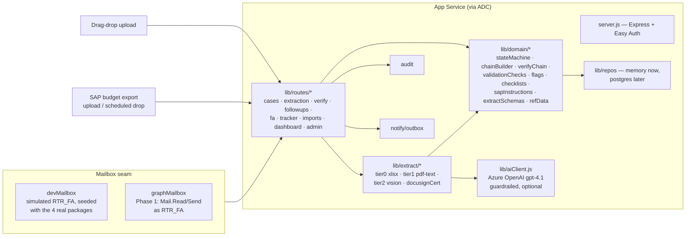
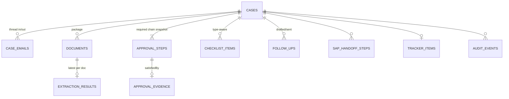

# ERD — Engineering Requirements Document

**Project:** AFE to Fixed Asset (AUC) Automation · **Version:** 0.2 (2026-08-27; v0.1 baseline 2026-08-26) · **Companion:** [PRD.md](PRD.md), [attachment-review.md](attachment-review.md), [implementation-plan.md](implementation-plan.md), [design-brief.md](design-brief.md)

**v0.2 delta:** the aggregate root becomes the **case** (mailbox/upload intake wrapper); document extraction pipeline (tiered, AI-assisted) added behind an `aiClient` seam; approval **verification** (DocuSign-certificate parsing against the snapshotted chain) replaces in-app routing as the primary path (routing stays dormant); mailbox adapter (Dev Mailbox → Graph) added as a third swap seam; graduation stack corrected to what the org actually runs (App Service + PostgreSQL Flexible Server, per the live Azure inventory).

---

## 1. Purpose & governing idea

A **workflow engine over data**, now fed by documents: everything hard — approval bands, the matrix, tracker semantics, SAP handoffs, extraction schemas, checklist templates — is *data plus one transition table*, so storage, mailbox, and AI implementations swap without touching the domain. The FA team is the only operator in v0.2; every AI output is a suggestion gated by FA confirmation.

Vibe-coding guardrails unchanged: few files, boring patterns, one home per concept, `CLAUDE.md` carries the invariants.

## 2. Platform constraints (Acme ADC — unchanged, P1–P7)

As v0.1: Node 20 + Express only, `server.js` root entrypoint, Easy Auth verbatim helpers, no GUIDs/localhost/.env anywhere, `PORT`/`0.0.0.0` binding, `/health`, in-memory data behind repos, single-file vanilla frontend. One addition:

| # | Constraint | Consequence |
|---|---|---|
| P8 | Outbound AI calls (Azure OpenAI) need endpoint + auth at runtime; ADC PoC forbids `.env`/secrets in source | AI endpoint/key arrive via platform app settings (`process.env.AOAI_ENDPOINT` etc.) read at runtime — never written in source or seeds; when absent, the app runs with extraction disabled (Wave-1 mode) and `/health` reports `ai: "not configured"` |

**Verified graduation stack** (from the live subscription — same pattern as Resume Screener/DIMS/Sample Ordering UATs): Azure **App Service** (+ ACR where containerized) + **PostgreSQL Flexible Server** + Key Vault + managed identity, `centralindia`/`westus`. v0.1's "Container Apps" reference is corrected to this.

## 3. Architecture overview (v0.2)



**Three swap seams, one pattern:** `repos` (memory→postgres), `mailbox` (dev→graph), `aiClient` (gpt-4.1→managed OSS via Foundry). Each is a factory returning the same async interface; each is exercised by the same routes either way.

## 4. Repository layout (v0.2 target)

Additions to the v0.1 layout:

```
lib/
  mailbox/
    index.js             # createMailbox("dev"|"graph") — seam #2
    devMailbox.js        # simulated inbox/sent, seeded from the 4 real emails; visibly "DEV"
  extract/
    index.js             # runExtraction(caseDoc) -> ExtractionResult (tier routing)
    tier0Xlsx.js         # direct workbook parse (named regions per template variant)
    tier1PdfText.js      # text-layer extraction -> aiClient structuring vs schema
    tier2Vision.js       # page renders -> aiClient multimodal -> same schema
    docusignCert.js      # DETERMINISTIC certificate parser (no AI)
  domain/
    verifyChain.js       # required chain × evidence -> per-level satisfied/missing/mismatch
    checklists.js        # type-aware required/expected document templates (data)
    extractSchemas.js    # normalized case schema + per-variant field mappings (data)
  aiClient.js            # seam #3: chat/vision/structured calls; env-configured; null-object when unconfigured
seed/
  dev-mailbox.json       # the four real intake emails (sanitized) + attachment references
  checklists.json        # Normal / Demo / RRC templates
public/demo-docs/        # the four packages' PDFs served for the doc viewer (PoC only, gitignored if size demands)
```

## 5. Data model (v0.2 delta)

Conventions unchanged (prefixed sequential ids, `version` columns, business keys). **`cases` becomes the aggregate root**; the v0.1 `afes` fields survive as the case's financial record (for RRC the record is contract-referenced instead of AFE-numbered).



| Entity | Key fields | Notes |
|---|---|---|
| **cases** | v0.1 afe fields **plus**: `source (email\|upload)`, `sourceEmailId`, `requestType (Normal\|Demo\|RRC)` FA-overridable, `intakeState`, `dedupeHashes[]` | One case = one intake package = one eventual IO/AUC. RRC: `afeNumber` holds the SAP contract/deal reference until numbering rules land (PRD Q4/Q8) |
| **case_emails** | `id, caseId, direction (in\|out), from, to[], subject, bodyText, receivedAt/sentAt, attachmentIds[], mailboxMessageId, threadId` | The coordination history — both the original intake mail and every follow-up |
| **documents** | attachment fields **plus**: `docType (afe_form\|vendor_quote\|docusign_cert\|contract\|cpq_quote\|internal_approval\|ial\|other)` FA-confirmable, `hasTextLayer`, `pageCount`, `sha256 (dedupe)` | Supersedes bare `attachments` for intake docs; evidence attachments unchanged |
| **extraction_results** | `id, documentId, caseId, tier (0\|1\|2), model, schemaVersion, fields: [{key, value, confidence, page, bbox?}], flags[], startedAt, completedAt, status` | Immutable per run; re-extraction appends. FA confirmation copies values onto the case (audited as `ai_suggested` → `fa_confirmed`) |
| **approval_steps** | v0.1 fields **plus** `verificationStatus (satisfied\|missing\|mismatched\|delegated)` | Same snapshot model; now populated by verification, not clicks |
| **approval_evidence** | `id, stepId, kind (docusign\|manual_email\|in_app), signerName, signerEmail, signerRole, signedAt, envelopeId, documentId` | From `docusignCert.js` or FA manual record; the mismatch logic lives in `verifyChain.js` |
| **checklist_items** | `id, caseId, label, source (template\|fa\|ai_suggested), state (pending\|satisfied\|waived), satisfiedByDocumentId, note` | FA decides; AI suggestions visually distinct and audited |
| **follow_ups** | `id, caseId, type (missing_doc\|missing_approval\|clarification\|aging_check\|package_return), draftBody, draftByAi, finalBody, recipients[], status (draft\|sent\|answered\|expired), sentEmailId, remindAt` | Draft vs sent text both retained (guardrail: audit AI vs human) |
| *(carry-over)* | afes-financial fields, afe_line_items, clarifications, service_date_forecasts, comments, audit_events, sap_handoff_steps, tracker_items, snapshot_imports/sap_budget_rows, notifications, users, cost_center_approvers | Unchanged from v0.1 |

## 6. Extraction pipeline contract

`runExtraction(document, caseType)` → `ExtractionResult`:
1. **Route**: `.xlsx` → tier 0 · PDF with text layer (probe once, store `hasTextLayer`) → tier 1 · else → tier 2. DocuSign certificate pages (detected by header text) → `docusignCert.js` regardless of tier.
2. **Schema** from `extractSchemas.js`: the normalized case schema (≈ the 15 workflow-driving fields + line items) with per-variant mappings (US form, APAC/Demo form, RRC package roles).
3. **Output** is never applied to the case directly — it renders in the review UI; FA confirm copies values (FR-EXTRACT-5).
4. **Failure is soft**: any tier failing marks the document `extraction_failed` with the error; the case proceeds with manual entry. Extraction never blocks intake.
5. **Idempotent & re-runnable**: results are append-only per document; the latest completed run is "current".

`aiClient` (seam #3): `structure(text, schema)`, `structureVision(pageImages, schema)`, `draft(prompt, context)` — all return `{content, model, usage}`; a null-object implementation (used when env is unconfigured, and in tests) returns `{disabled: true}` so Wave-1 behavior is fully deterministic. Guardrails in the client: request/response logging to audit (excluding raw document bytes), token caps, no retries that duplicate sends, prompts carry only the case's own content.

## 7. Case lifecycle (v0.2)

The v0.1 transition table stands; v0.2 renames the front of the funnel and reduces `pending_approval` to an *optional* path:

`intake` (case created; extraction + checks run) → `in_review` (FA workspace) → `waiting_external` (follow-ups out: docs/approvals/clarifications — replaces requester-facing `returned_for_clarification` as the umbrella) → `accepted` (validation done; = v0.1 fa_validation accept) → `sap_handoff` → `in_construction` → `pending_capitalization` → `capitalized` → `closed`; terminals `rejected`, `cancelled`. `pending_approval` (in-app routing) remains implemented, entered only if a case is switched to in-app routing mode (W3).

Rules preserved: chain snapshot immutability, resume-vs-restart on financial change, four-eyes close, cancel blocked after handoff starts, flags as derived overlay.

## 8. API surface (v0.2 additions)

| Area | Routes |
|---|---|
| Mailbox | `GET /api/mailbox/inbox` · `POST /api/mailbox/:messageId/create-case` · `POST /api/mailbox/send` (adapter-routed; Dev Mailbox marks sends as simulated) |
| Cases | `POST /api/cases` (upload package) · `GET /api/cases?state=&type=` · `GET /api/cases/:id` (documents, extraction, verification, checklist, follow-ups, emails, audit) |
| Extraction | `POST /api/cases/:id/documents/:docId/extract` · `GET .../extraction` · `POST /api/cases/:id/confirm-fields` (FA confirmation copies values, audited) |
| Verification | `GET /api/cases/:id/verification` (required chain × evidence) · `POST /api/cases/:id/evidence` (manual approval evidence) |
| Checklist | `POST /api/cases/:id/checklist/:itemId/{satisfy\|waive}` · `POST /api/cases/:id/checklist` (add item) |
| Follow-ups | `POST /api/cases/:id/followups/draft` (AI, W2) · `POST /api/cases/:id/followups/:fid/send` · `GET /api/cases/:id/followups` |
| *(carry-over)* | fa queue, handoff, tracker, imports, dashboard, notifications, admin — unchanged |

## 9. Seams & phase plan (v0.2)

| Seam | PoC | Phase 1 | Phase 2 |
|---|---|---|---|
| `repos` | memory + seeds | PostgreSQL Flexible Server (App Service pattern) | — |
| `mailbox` | devMailbox (seeded, simulated sends) | `graphMailbox` on `RTR_FA` (Mail.Read + Mail.Send as mailbox; PRD Q22) | shared-mailbox automation rules |
| `aiClient` | Azure OpenAI gpt-4.1 (existing accounts; env-configured; off = Wave-1 mode) | same + eval-driven OSS trial via Foundry project | SAP cost cross-checks etc. |
| `sapClient` | manual handoffs (unchanged) | — | per-step BAPI/OData automation (unchanged seam) |
| attachments/documents | in-memory + demo-docs | Azure Blob | — |

## 10. Security, SOX & data handling (v0.2 additions)

v0.1 provisions stand. Added: AI guardrails per PRD §7 (in-tenant only, HITL gates, confidence thresholds, dual-value audit, prompt minimization); document store treats every intake attachment as internal-confidential; Dev Mailbox seeds are sanitized copies of the four real emails (real names retained — repo stays private, consistent with the matrix seed); extraction logs never persist raw document bytes; `/health` reports ai/mailbox seam status without leaking endpoints.

## 11. Non-functionals (v0.2 delta)

Extraction latency target: < 30 s per document (async job with progress in the UI; never blocks case creation). AI cost ceiling: trivial at tens of docs/day on gpt-4.1. Everything else per v0.1.

## 12. Engineering conventions

Unchanged, plus: extraction schemas and checklist templates are **data** (`extractSchemas.js`, `checklists.json`); never call `aiClient` outside `lib/extract/*` and the follow-up drafter; every AI call site must handle `{disabled: true}`.
