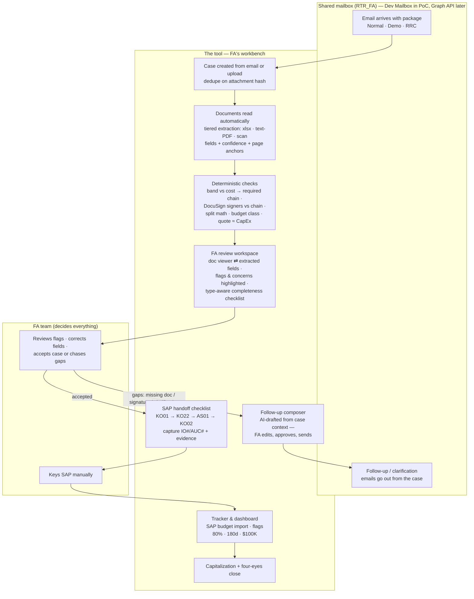

# PRD / BRD — AFE to Fixed Asset (AUC) Automation

| | |
|---|---|
| **Document** | Combined Business & Product Requirements (PRD/BRD) |
| **Project** | AFE → AUC → Fixed Asset process automation ("AFE to Fixed Asset Automation") |
| **Author** | Shashank Srivastava (FDE), analysis assisted by Claude |
| **Version** | **v0.2 — 2026-08-27.** FA-first re-scope: document-first intake with automated extraction, approval *verification* over approval *routing*, mailbox-centric coordination with AI-drafted follow-ups, requester persona parked. v0.1 (2026-08-26) was the meeting-derived baseline. |
| **Sources** | Kick-off meeting 2026-08-25 (full transcript), Teams follow-up thread, SOP v1.0 draft (11-Aug-2026), AFE Global Form 06.01.GLB.FRM.00070 Rev 6 (US + APAC/Demo variants), process flowchart, cost-center approver matrix (2,561 rows), SAP Budget/Actual/Commitment export (14k rows), AUC tracker workbook (21 sheets), **four real intake emails with full attachment packages — see [attachment-review.md](attachment-review.md)** |
| **Stakeholders** | Euan Branaola (sponsor), Jarrod Dane (process owner), Judithmelanie Ware (FA ops lead), Ebony Lowe (FA ops), Imogen Blanche (SAP reporting), Manaia Ginty, Lyndsay Radhakrishnan |

---

## 1. Executive summary

Acme's Global FSSC Fixed Asset team (India) administers the capital-expenditure lifecycle — **AFE → SAP Internal Order (IO) → Asset Under Construction (AUC) → capitalized Fixed Asset** — for **13 company codes**. The process runs on emails into a shared mailbox (`RTR_FA@example.com`), attachment packages (AFE forms in two regional variants, vendor quotes, DocuSign certificates, rental contracts), manual validation and SAP keying, hand-written follow-up emails, and a 21-sheet Excel tracker. Two SOX control points live inside this manual fabric.

**Product thesis (v0.2): meet the FA team where they are — the mailbox — and automate where they don't want to be.** The FA team brought the problem; the trigger for all their work is a received email with documents. So the tool's front door is the **case**: created from the mailbox (or a drag-and-drop upload), its documents **read automatically** — fields extracted, arithmetic and classification checked, the required approval chain computed from cost center + value, and the **DocuSign certificate cross-checked against that chain** — so FA opens a pre-analyzed case instead of a blank form and a PDF. What stays manual is judgment: FA decides what's missing, what needs chasing, and what goes into SAP; the tool supports that judgment with type-aware checklists and **AI-drafted, FA-approved follow-up emails**. Requester-facing features are **parked** (built at FA level; exposure decided later).

SAP remains the manual transactional system with explicit handoffs (unchanged from v0.1). The dashboard/tracker replacing the Excel workbook remains in scope (already working against real data).

### Primary goal
Remove the FA team's mechanical work (reading documents, checking bands and signatures, re-keying, tracker upkeep, drafting chase emails) while keeping every decision — completeness, acceptance, SAP entry, follow-up wording — in FA hands.

---

## 2. Personas & roles (v0.2 focus)

| Persona | Status | What the tool gives them |
|---|---|---|
| **FA Preparer** (Judithmelanie, Ebony + team) | **Primary — build everything here** | Mailbox-fed case queue; automatic document reading with flagged concerns; band + named-chain computed per case; DocuSign signature verification; type-aware completeness checklist; one-click AI-drafted follow-ups (they edit & approve); SAP handoff checklists with evidence capture; live tracker & dashboard |
| **FA Checker** (independent, SOX) | Primary | Four-eyes close-out; complete per-case audit trail incl. AI-suggested vs FA-confirmed values |
| **Finance Leadership** (Jarrod, Euan) | Primary (read) | Single-pane dashboard; case aging; follow-up SLA visibility |
| **Admin** | Primary | Matrix upkeep, checklist templates, mailbox connection, AI guardrail settings |
| **Requester** (facility/plant/PM/GSC) | **Parked** | Continues to work in email exactly as today — zero new work. Requester-facing form/status views exist in the codebase but are FA-operated for now; exposure decided post-review |
| **Approvers** (M1–A9) | Parked | Approvals continue via DocuSign/email as today; the tool *verifies* rather than *routes*. In-app routing (built in the scaffold) is kept dormant for a later phase |
| **SAP Reporting** (Imogen) | Unchanged | Defined export contract feeding the dashboard |

---

## 3. Current-state process (as evidenced)

Nine SOP steps, two SOX controls — unchanged from v0.1 (see the table below). What v0.2 adds is **evidence of how work actually arrives**, from the four real intake packages ([attachment-review.md](attachment-review.md)):

- Requests land in the shared mailbox in at least three shapes: **Normal** (signed AFE + quote), **Demo/APAC** (1-page template variant, local currency, "AFE NO: to be added by CS or Asset team"), **RRC/rental** (no AFE at all — signed contract + CPQ quote + scanned internal approval + installation list, "please create IO for this deal").
- Approvals mostly arrive **already collected** via DocuSign; the certificate pages carry machine-readable signer names, emails, roles, and timestamps.
- Coordination friction is real and specific: a $25,600 AFE (crossing the $25K band by $600) took 3 signers and ~28 hours after a controller red-lined a prior version; the same request email arrived twice; FA pasted SAP MM03 cost screenshots into a package as validation evidence; only 50–60% of forms arrive correctly prepared.

| # | Step | System | Key detail |
|---|---|---|---|
| 0 | Intake | Email | Packages to `RTR_FA@example.com`; types Normal / Demo / RRC; AFE number often assigned by FA |
| 1 | Receive & validate | Manual + SAP lookups | Matrix band vs Total Project Cost; budget classification; quote ≈ CapEx/OpEx (~80%); company code; vendor details; SAP cost cross-checks |
| 2–5 | IO `KO01` (Z002, IO#=AFE#) · budget `KO22` (R&D exempt) · AUC `AS01` · settlement `KO02` (FXA 100%) | SAP | Work Start = SAP creation date (drives SOX aging) |
| 6 | **SOX 1** — monthly settlement by WD4 (`KOB1`, `KO88`/`KO8G`, test→live, independent checker) | SAP | Unchanged by this project |
| 7 | Finalize & circulate package (IO#, AUC#, GL guidance) | Email | Requester must charge the IO, not the cost center |
| 8 | **SOX 2** — tracker & aging review; flags ≥80% consumed · ≥180 days · >$100K (firm-date exclusion) | Excel | Preparer/Reviewer comments; reconciles to FS10/GL |
| 9 | Capitalize (`AIBU`), close tracker row | SAP | Final Service Date; four-eyes close |

---

## 4. Future-state workflow (v0.2)

The v0.1 swimlane (requester-initiated digital form → in-app sequential approvals) is **retained as a later-phase path** — the deterministic chain engine that powers it now powers *verification* instead.

---

## 5. Scope, waves & prioritization (pointer-8 ordering)

### Wave 1 — deterministic, lowest-hanging (PoC core)
| In | Notes |
|---|---|
| Case intake from Dev Mailbox (simulated shared inbox seeded with the four real emails) + manual upload | Graph API connection is a config swap later |
| Duplicate detection (attachment hash / envelope ID) | Case B arrived twice |
| Band + named approver chain per case (cost center + value) | Built and tested in the scaffold |
| **DocuSign certificate parsing → approval verification** (signers/timestamps vs required chain; gap flags) | Deterministic; the single highest-leverage check |
| Arithmetic & classification checks (split = total; line items = CapEx; budget classification consistency; quote ≈ CapEx tolerance) | Run on extracted or FA-entered data |
| Type-aware completeness checklists (Normal / Demo / RRC) — static templates FA can tick/override | AI suggestions come in Wave 2 |
| AFE number registry (issue/record) | Pending Q4 numbering ownership |
| Case workspace: FA-operated intake form (the "digital twin" FA corrects), status, comments, audit | Reuses scaffold |
| SAP handoff checklists + evidence capture; tracker; dashboard; SAP budget import | Built and tested in the scaffold |

### Wave 2 — most painful patterns, AI-assisted
| In | Notes |
|---|---|
| **Tiered document extraction**: xlsx direct-parse → text-layer PDF + LLM structuring → scan/vision path; per-field confidence + source-page anchors; side-by-side review UI | gpt-4.1 already deployed in the sandbox; see §7 |
| Flag & highlight key areas of concern on the document itself | Low-confidence fields, failed checks, unusual values |
| **Follow-up email drafting**: AI drafts from case context (what's missing, who to ask, prior thread); FA edits/approves; send via Dev Mailbox (Graph later); full history on the case | The #1 coordination pain |
| Completeness suggestions ("similar RRC cases carried an IAL — none attached") | Assist, never decide |
| Reminder scheduling on unanswered follow-ups | |

### Wave 3 — decide post-review
Requester-facing surfaces (form, status self-service) · in-app approval routing (dormant code) · SAP cost cross-check automation (MM03 pattern) · live Graph send/receive on `RTR_FA` · scheduled SAP extract ingestion · Phase-2 SAP write integration (existing seam).

### Explicitly out (unchanged)
SAP writes in Phase 1 · monthly WD4 settlement execution (SOX 1 stays in SAP) · multi-language.

---

## 6. Functional requirements (v0.2 delta + carry-over)

New/changed modules first. *(W1/W2/W3)* = wave. Carry-over modules from v0.1 (FR-HANDOFF, FR-TRACK, FR-FLAG, FR-DASH, FR-ING, FR-AUDIT/ADMIN) remain as written there, now FA-operated.

### FR-CASE — Case & mailbox intake *(W1)*
- **FR-CASE-1** A case is created from an inbound mailbox message (Dev Mailbox in PoC; Microsoft Graph on `RTR_FA@example.com` later behind the same adapter) or by manual upload of a document package.
- **FR-CASE-2** Case carries: source email metadata (from, subject, received-at, thread), documents, detected request type (Normal/Demo/RRC — FA can override), and the full coordination history (every email in/out, every follow-up, every status change).
- **FR-CASE-3** Duplicate intake detection by attachment hash/envelope ID; duplicates attach to the existing case, flagged.
- **FR-CASE-4** The FA queue is the landing page: new / in review / waiting on requester / waiting on approvals / ready for SAP / in construction / pending capitalization.

### FR-EXTRACT — Document reading *(W2, with W1 fallback = FA keys the form manually)*
- **FR-EXTRACT-1** Tiered extraction to one normalized schema: (T0) attached `.xlsx` parsed directly; (T1) text-layer PDFs → layout text → LLM structuring; (T2) scanned pages → multimodal extraction. Every extracted field carries value, confidence, and source-page anchor.
- **FR-EXTRACT-2** Handles both form variants (US multi-page; APAC/Demo 1-pager with product table + local currency) and non-AFE packages (RRC: contract, CPQ quote, approval, IAL) mapping to case-type-specific schemas.
- **FR-EXTRACT-3** **DocuSign Certificate of Completion parsing is deterministic** (no LLM): envelope ID, signers (name, email, role), sent/viewed/signed timestamps.
- **FR-EXTRACT-4** Side-by-side review: document page on one side, extracted fields on the other; low-confidence and check-failing fields highlighted; FA corrects and confirms. Confirmed values become the case of record; AI-suggested vs FA-confirmed both audited.
- **FR-EXTRACT-5** Nothing auto-advances on AI output alone: extraction produces a *proposed* case; FA confirmation is the gate (human-in-the-loop guardrail).

### FR-VERIFY — Approval verification (replaces v0.1 in-app routing as the primary path) *(W1)*
- **FR-VERIFY-1** Compute the required chain (band × cost-center matrix, named people) for the case value — same engine as v0.1.
- **FR-VERIFY-2** Match DocuSign-certificate signers (and FA-recorded manual evidence) against the required chain; per-level status: satisfied / missing / mismatched-person / delegated-with-evidence.
- **FR-VERIFY-3** Gap output feeds the follow-up composer ("A1 and A2 signatures required for $25,600 — draft chase to …").
- **FR-VERIFY-4** The v0.1 in-app sequential routing remains available (dormant) for the later requester-facing phase.

### FR-FOLLOWUP — Coordination & follow-ups *(W1 manual send · W2 AI drafting)*
- **FR-FOLLOWUP-1** Follow-up composer on every case: recipient(s), subject, body; sends through the mailbox adapter (Dev Mailbox in PoC — visibly simulated; Graph later); thread recorded on the case.
- **FR-FOLLOWUP-2** *(W2)* AI drafts the email from case context: what's missing/flagged, prior correspondence, tone = professional Acme finance. FA always edits/approves before send; drafts and edits are audited.
- **FR-FOLLOWUP-3** Follow-up types: missing document · missing approval · clarification (field mismatch) · aging/utilization check (SOX 2, from the tracker flags — carry-over) · completed-package return (SOP step 7).
- **FR-FOLLOWUP-4** Unanswered follow-ups resurface in the queue after a configurable interval.

### FR-CHECKLIST — Completeness *(W1 static · W2 suggestions)*
- **FR-CHECKLIST-1** Type-aware required/expected document checklists (Normal: signed AFE + vendor quote; RRC: signed contract + CPQ + internal approval + IAL; Demo: signed variant form). FA ticks, overrides, and adds items — FA decides; the checklist remembers.
- **FR-CHECKLIST-2** *(W2)* Suggestions from case content and history; suggestions are visually distinct from FA-confirmed items.

### FR-FORM — FA-operated intake form *(W1; requester exposure = W3)*
- v0.1 FR-FORM requirements stand, operated by FA as the correction surface for extraction (and manual entry fallback). Chain preview stays.

*(Carry-over unchanged: FR-HANDOFF-1..5, FR-TRACK-1..5, FR-FLAG-1..4, FR-DASH-1..3, FR-ING-1..4, FR-AUDIT-1..2, FR-ADMIN-1..3.)*

---

## 7. AI & extraction approach (pointers 1 and 6)

**Answer to the ColPali / Document Intelligence question:** neither is required to start. ColPali-style visual RAG solves corpus *retrieval*; this is single-document *structured extraction* against known schemas. A dedicated Azure AI Document Intelligence resource is an optional Tier-2 add-on if evals show table-fidelity gaps on scans. Full reasoning + evidence: [attachment-review.md §3](attachment-review.md).

**Verified access (Azure MCP, 2026-08-27, subscription `GIT - Sandbox - Development`):** Azure OpenAI accounts `ResumeScreenerOAI` (eastus: gpt-4.1 GlobalStandard 250K TPM, text-embedding-3-large) and `dev-task-analyze` (westus3: gpt-4.1). gpt-4.1 is multimodal → covers text structuring and scan extraction with **zero new infrastructure**. No Foundry project or Document Intelligence resource exists yet; both are sandbox-creatable when wanted.

**Managed open-source (user preference):** workload is light (tens of docs/day), so the driver is accuracy, not cost. Plan: ship on gpt-4.1; build a labeled eval set from the four real packages; trial a managed OSS model (Phi-4-multimodal / Mistral-class via a Foundry project) behind the same `aiClient` seam; switch if accuracy holds.

**Guardrails (designed-in):**
1. Data residency: all AI calls stay in the Acme Azure tenant (existing accounts; private-endpoint patterns already in use in this subscription). No third-party endpoints.
2. Azure OpenAI policy: no training on inputs; content filtering on.
3. Human-in-the-loop everywhere: extraction → FA confirms; email drafts → FA edits/approves; completeness → suggestions only.
4. Confidence gating: fields below threshold are never pre-accepted, always flagged.
5. Auditability: AI-suggested value, FA-confirmed value, and AI-drafted vs sent email text are all recorded per case.
6. Minimization: prompts carry only the case's own documents/fields — never the matrix in bulk, never other cases.

---

## 8. Business rules (unchanged from v0.1)

Approval bands table, quote tolerance (~80%, Q6), request-type variations (Normal/Demo/RRC), R&D KO22 exemption (Q7), SOX control preservation — all as in v0.1 §7. The bands now power **verification** first, routing later.

## 9. Constraints & current workarounds (v0.2 additions)

v0.1 C1–C10 stand. Added:

| # | Constraint | Treatment |
|---|---|---|
| C11 | Graph API access to `RTR_FA` not yet granted | Mailbox **adapter**: Dev Mailbox (simulated, seeded with the four real emails) in PoC; `graphMailbox` swap when granted — same interface as the repos/notifications seams |
| C12 | Some package documents are scans (no text layer) | Tier-2 vision/OCR path; never block a case on extraction failure — FA manual entry is always available |
| C13 | Two AFE template variants (US, APAC/Demo) + free-form RRC packages | One normalized case schema; type-specific extraction mappings |
| C14 | Approvals happen in DocuSign outside the tool | Certificates are the evidence; parse + verify rather than route |

## 10. Assumptions (v0.2 delta)

A1–A12 from v0.1 stand except: **A-R1** requester-facing surfaces are parked (supersedes the v0.1 requester-first framing); **A-R2** approvals continue via DocuSign/email in Phase 1 — the tool verifies; **A-R3** Dev Mailbox simulation is acceptable for the PoC demo of read-and-send; **A-R4** gpt-4.1 on existing accounts is acceptable for the PoC (per pointer 6), with the OSS eval to follow; **A-R5** extraction never auto-advances a case (human-in-the-loop is a hard rule, not a preference).

## 10b. Working session with Judithmelanie Ware (2026-08-31) — rules established

The mid-development review with the FA process owner established the following. Where a
rule contradicted an assumption in the build, the build was corrected.

| Rule | Detail | Status |
|---|---|---|
| **AFE number = SAP internal-order number** | The number does not exist at intake. SAP generates it when the FA saves KO01, and *that* number is the AFE number. Corroborated twice: both real signed forms have **AFE NO blank**, and Document Intelligence returns `AfeNumber: null` on the real package. | **Corrected** — the KO01 sheet no longer asks for one; it is captured back after handoff |
| **Order type Z002 or Z005** | Chosen by the nature of the AFE; known to the preparer who writes the form. | Sheet offers both — **Q25** below (parked per Shashank, 2026-09-02) |
| **KO01 tabs (from the recording, IO 313403)** | Real order: Assignments · Control data · Prd-end closing · General data · Investments. Control data + Prd-end closing take nothing; Investments stays empty (asset class at AS01); Estimated costs stays 0.00 (budget via KO22); Work Start/End of Work carry the AFE's estimated dates. | **Received 2026-09-02** — keying sheet rebuilt field-for-field |
| **Budget step exempt for Demo & RRC** | Checklist remark, confirmed verbally: "for RRC we need not to update the budget. This is for the normal assets." | **Corrected** — KO22 is dropped for both types |
| **Closure is a quarterly no-cost review** | Not a fixed monthly rhythm. FA lists IOs with no cost movement, emails the requester, and closes on confirmation. ~99% of closures are done by FA, not the requester. *(Monthly WD4 settlement under SOX 1 is a separate, unchanged control.)* | **Added** — **Q27** on the exact no-cost window |
| **Capitalize to 105% of budget** | Beyond that a supplemental AFE/budget must be requested before the asset can be capitalized. | **Added** as `CAPITALIZATION_TOLERANCE` — **Q28** to confirm |
| **Supplemental AFE is an AUC-review question** | "Supplemental AFE is required when we are reviewing the AUC file. Not at the initial point." | **Corrected** — no longer asked at intake |
| **The three flags are the AUC quarterly-review inclusion rules** | Printed in the AuC Recon workbook: ≥80% consumed · aged ≥6 months from IO issue date · >$100K, **excluding** projects already confirmed with a go-live beyond the reviewed period. | **Implemented** as the S7 population |
| **Each flag drives a different action** | ≥80% → chase **monthly**. ≥180 days → chase for **in-service / put-to-use date**. >$100K → **no separate cadence**; a priority marker so high-value items are never missed. | **Implemented** |
| **Leadership wants the reason, not the totals** | "It is required for the requester only, not at higher management. They just want to see why there is no capitalization." | **Implemented** — the dashboard leads with reason counts |
| **The AUC confirmation email is the top non-SAP ask** | Judithmelanie's first answer when asked what to automate: "that is also challenging for us." | **Implemented** as S7 confirmation packs |
| **SAP GUI is a desktop application behind VPN** | No browser automation is possible; the keying sheet remains the handoff mechanism. | Constraint recorded |
| **Judithmelanie's target end state** | "A web form that fetches the detail from SAP itself, and if anything is due it populates the email to that requester, and the requester updates the comments in that web form." | Phase-1.5 direction — S7 plus a read-only SAP extract, no SAP writes |

**Rated low value by the process owner:** the AI field-confirm ledger — *"I don't think it
will be much useful for us"* — but explicitly **not to be scrapped** (*"we can discuss with
the larger forum"*). The same extracted fields **are** wanted for IO creation: *"the fields
which you have just extracted from the AFE form, that can be useful at the time of IO
creation, that we need to just copy paste."* The ledger is therefore collapsed by default
and its values surface on the KO01 sheet.

**Also found on the real signed form** and now extracted: Project Type (previously
mis-read *as* the Title), Location, Project Code, Cloud CapEx, and the customs *Assist*
question. Two approval tracks remain unmodelled and need a decision — **Q29**: the
*Controllership Review* row (triggered by >$1M USD in labor cost) and the separate
*Project Approvals* block (Group + Approver, e.g. "GSC Assoc Director").

## 10c. Direction change — Early Review (2026-09-02)

The Early Review reversed the FA-first premise: **the tool must start with the requester
creating the AFE**, route approvals automatically from cost centre × cost, take approver
decisions in-tool, and only then hand a complete, approved AFE to Fixed Assets for a
judgmental check and issue. Everything built for FA in v0.2 is retained as step ⑤ (AUC review)
and as Phase-2 material. The full requirements, the template decomposition, the wizard design
principles and the approach are in **[v0.3-requester-first.md](v0.3-requester-first.md)**;
the re-imagined screens are on the *AFE Requester-First Workbench* design canvas
(`design/v0.3/`). Questions **Q30–Q40** live in that document.

## 11. Open questions for stakeholders (v0.2 status)

Evidence answered/moved several v0.1 questions:
- **Q4 (AFE numbering)** — partially evidenced: the APAC form prints "AFE NO: To be added by CS or Asset team", and Case A requests number assignment. Remaining ask: the numbering scheme/ranges per company code so the tool can become the registry.
- **Q8 (RRC intake)** — evidenced: RRC arrives with **no AFE form** (contract + CPQ + approval + IAL; SAP contract # in the email). Remaining ask: confirm the RRC checklist + which amounts drive the IO/AUC values (CPQ annual vs term total).
- **New Q21 (Jarrod/Judithmelanie):** which checks may *hard-block* a case vs always warn? (Proposal: everything warns; FA decides — consistent with pointer 3.)
- **New Q22 (Euan):** Graph API permission request for `RTR_FA` (Mail.Read + Mail.Send as the mailbox) — who sponsors, expected lead time?
- **New Q23 (Judithmelanie/Ebony):** the standard follow-up email skeletons per situation (missing approval / missing doc / aging check / package return) — share 2–3 real sent examples per type to ground the AI drafts.
- **New Q24 (Euan/IT):** data-protection review for AI use: confirm Azure OpenAI in-tenant processing satisfies policy for finance documents (vendor quotes, approver names, budget data).
- **New Q25 (Judithmelanie):** the Z002 vs Z005 selection rule — which nature of AFE maps to which order type?
- **New Q26 (Judithmelanie/Ebony):** requester and reviewer **mailboxes**. The approver matrix and the AuC Recon file carry names only, so no follow-up can be addressed automatically. Is there a name→mailbox source, or should FA maintain a mapping?
- **New Q27 (Judithmelanie, parked 2026-09-02):** the closure review window — the session recording says IOs "with no cost from the last three years"; the workbook's review rule is "aged 6 months or older". Confirm the no-cost window that triggers a closure question.
- **New Q28 (Judithmelanie, parked 2026-09-02):** confirm capitalization is permitted up to **105%** of approved budget, and that exceeding it requires a supplemental AFE before capitalizing.
- **New Q29 (Jarrod/Judithmelanie):** should the tool verify the **Controllership Review** (>M labor cost) and the **Project Approvals** block, or are those outside the FA control?
- Q1 (chain ordering), Q2 (matrix coverage), Q5–Q7, Q10–Q20 stand as in v0.1.

## 12. Success metrics (v0.2 emphasis)

| Metric | Baseline | Target |
|---|---|---|
| FA minutes per intake case (open package → validated case) | ~30–60 min manual reading/checking | **< 5 min review of pre-analyzed case** |
| Approval-gap detection | Manual matrix lookup | 100% automatic per case (deterministic) |
| Follow-up email effort | Hand-written per case | Draft in one click; FA edits only |
| Forms/packages right-first-time | 50–60% | Flags on 100% of defects at intake |
| Tracker upkeep + status answering | Manual workbook + ad-hoc email | System-maintained (unchanged from v0.1) |
| Extraction field accuracy (eval set) | — | ≥ 98% on band-driving fields (value, cost center, type); ≥ 95% overall before Wave-2 sign-off |

## 13. Path to value (v0.2)

1. **Design first:** UI refined in Claude Design from [design-brief.md](design-brief.md) before further feature building (pointer 10).
2. **Wave 1 demo:** Dev Mailbox → case → deterministic checks (band/chain, DocuSign verification, arithmetic) on the four real packages → follow-up composer (manual text) → SAP handoff → tracker/dashboard. Everything demoable without any AI dependency.
3. **Wave 2 demo:** the same four packages, now auto-extracted with flags and one-click drafted follow-ups; measured against the labeled eval set.
4. **Post-review:** decide requester exposure, Graph go-live, OSS model swap, Phase-2 SAP integration.

---
*Companion documents: [attachment-review.md](attachment-review.md) (evidence), [ERD.md](ERD.md) (engineering), [implementation-plan.md](implementation-plan.md) (build plan), [design-brief.md](design-brief.md) (for Claude Design).*
