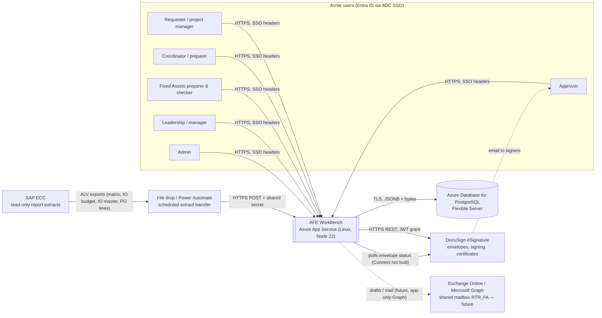
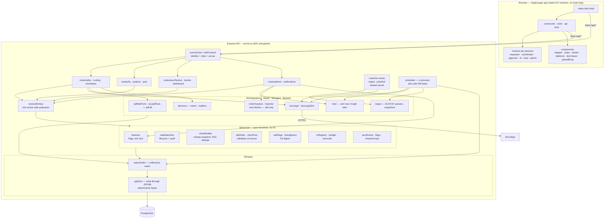
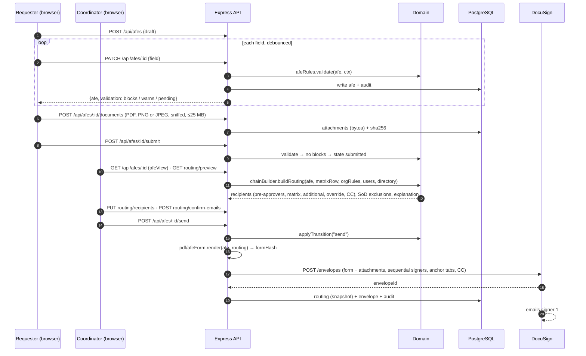
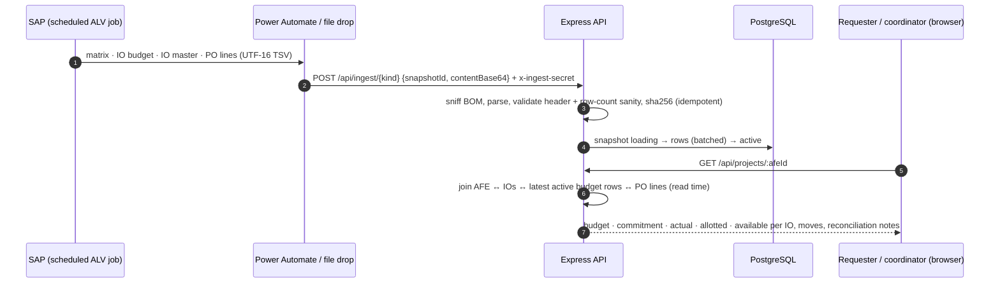

# AFE Workbench — Architecture

| | |
|---|---|
| **Document** | Architecture description (seed of the System Design Document for security review) |
| **Version** | 0.5-draft-1 · 2026-09-14 |
| **Status** | For security review. **§16 is new and changes a boundary this document previously stated as absolute — read it first.** |
| **Scope** | The AFE Workbench as built and deployed to UAT on 2026-09-11, plus what Meeting #5 (2026-09-11) added. Describes the target system; where the current UAT build differs, it says so. |
| **Related** | `docs/v0.4-blueprint.md` §11 (requirements R63–R91) · `docs/v0.3-requester-first.md` (R15–R40) · `docs/PRD.md` · `docs/adc-onboarding-request.md` · `CLAUDE.md` (deployment rules) |

---

## 1. Purpose and boundaries

The AFE Workbench is an internal Acme web application for the **Authorization For Expenditure (AFE)** process:
a requester creates an AFE in a guided wizard, a divisional coordinator (where one exists) completes and routes it,
approvers sign it in **DocuSign**, Fixed Assets (FA) performs a judgmental check and creates the SAP internal order
(IO) manually, and the tool then tracks the resulting Assets under Construction (AUC) — budget, commitment, actual,
quarterly review, capitalization. It replaces the Excel template → PDF → DocuSign → email chain used today.

**Boundaries that matter for security review**

- **AI is bounded, flagged, and never decides** (changed 2026-09-14 — see **§16**, which this review needs to read
  first). Every rule, validation, classification, email body and the PDF itself remain deterministic code in this
  repository. A model is used only to READ unstructured input a person reads today — a vendor quote, a reply to a
  chase — and only behind a feature flag that ships OFF and that `FEATURES_LOCKED` can forbid per environment. What
  it produces is a proposal with a confidence that a person confirms before it counts. **No AI service is enabled in
  any environment before this review has seen it.**
- **No SAP writes.** SAP remains the system of record for internal orders, budgets and assets. The tool only
  *reads* scheduled SAP report extracts and *displays* keying instructions; FA keys SAP by hand.
- **Signatures are DocuSign's.** The tool generates the AFE document and creates the envelope; the legal signature,
  certificate of completion and tamper evidence are DocuSign's. The tool stores the completed documents as evidence.
- **Single tenant, internal users only.** Identity comes from Acme Entra ID through the ADC platform's SSO; there is
  no local account store, no password handling, no public surface beyond the SSO-protected app.

---

## 2. System context



| Neighbour | Direction | Protocol / auth | Data exchanged | Status |
|---|---|---|---|---|
| Entra ID via ADC Easy Auth | inbound | HTTPS; platform injects `x-ms-client-principal*` headers | user principal name, display name | UAT has **no** Easy Auth (demo identity); production onboarding adds it |
| DocuSign eSignature REST v2.1 | outbound only — the app polls for status; DocuSign Connect (an inbound webhook) is **not built** | HTTPS; OAuth 2.0 **JWT grant** with a service user | AFE Form PDF, attachments, signer names/emails, envelope status, completed PDF, certificate | simulated until Acme provides an integration key |
| SAP (via scheduled extract) | inbound | HTTPS POST from Power Automate / file drop with `x-ingest-secret`; or manual upload by FA | approver matrix (names per cost centre), per-IO budget/actual/commitment, IO master, PO lines | manual upload today; scheduled transfer to be arranged (Euan) |
| Exchange Online via Microsoft Graph | outbound | HTTPS; app-only token scoped to the `RTR_FA` mailbox | notification mails; **drafts** of the FA red-flag digest (never auto-sent) | future — needs an app registration; `.eml` download is the fallback |
| Azure PostgreSQL Flexible Server | outbound | TLS | all application data | live (`pg-afe-workbench-india`, Central India) |

---

## 3. Components



**Design rules enforced by structure**

- **Domain is pure.** `lib/domain/*` receives plain objects and returns plain objects; it never touches storage,
  the network or the clock except through arguments. This is what makes rules testable (`tools/smoke-*.js`) and
  makes the audit trail complete: every mutation goes `guard → repo write → audit.record → notify.enqueue`.
- **One lifecycle mutator.** `stateMachine.applyTransition()` is the only code allowed to change an AFE's state;
  routes call it. The UI only hides buttons — the server enforces.
- **Snapshots, not references.** Routing (who must sign, in which order, from which matrix batch and rules) is
  frozen when the envelope is sent. Later matrix changes never mutate an in-flight chain; they raise a red flag.
- **Derived at read time.** Validation, red flags, matrix drift, the KO01 keying sheet, AUC review flags and
  per-IO figures are computed when read, from stored facts — so there is nothing to get stale or to reconcile.
- **Every external system sits behind a seam with a simulation mode.** DocuSign, mail, directory lookup and SAP
  ingest are env-gated; when unconfigured, a clearly labelled stand-in keeps the product usable in UAT.
- **Master data is edited where the business already edits data.** `lib/mdm` exports each master as the workbook
  it imports from, upserts by key, never deletes, and keeps the last twenty versions so a bad import is undone by
  restoring one rather than by repairing rows. Where SAP is the system of record — the approver matrix, the budget
  rows, the order master, the PO lines — nothing but an extract may change it, and the export is read-only.
  `lib/xlsx` reads and writes SpreadsheetML on Node's own `zlib`, so this cost no dependency; it is proved in both
  directions against a workbook real Excel saved (`tools/fixtures/`).

---

## 4. Key data flows

### 4.1 Request → send for signature



### 4.2 Signing, verification, FA hand-over

```mermaid
sequenceDiagram
  autonumber
  participant DS as DocuSign
  participant JOB as Scheduler (poll)
  participant API as Express API
  participant DB as PostgreSQL
  participant FA as Fixed Assets (browser)

  JOB->>DS: GET /envelopes?from_date=…&include=recipients (every 10 min)
  DS-->>JOB: status changes
  JOB->>API: applyTransition("recipient_signed" | "decline" | "voided")
  Note over API: on the last signature
  API->>DS: GET /envelopes/{id}/documents/combined + /certificate
  API->>DB: store completed PDF + certificate (bytea, sha256)
  API->>API: compare API recipients with the routing snapshot → verification[]
  API->>DB: state approved → fa_review; outbox row for FA
  FA->>API: GET /api/fa/afes/:id
  API-->>FA: afeView + redFlags (rules, matrix drift vs current matrix, verification misses)
  FA->>API: POST red-flags/draft
  API-->>FA: .eml draft (X-Unsent) — never auto-sent
  FA->>API: POST judgment · POST record-io {ioNumber, childIos}
  API->>DB: ios + afeNo + audit; outbox to requester and coordinator
```

**Not built: DocuSign Connect.** Status arrives by polling (`lib/jobs/pollEnvelopes.js`). If Connect is added
later it would post to `POST /api/docusign/connect`, verify the `X-DocuSign-Signature-1` HMAC on the raw body,
de-duplicate, and **re-read the envelope from the API** rather than trust the payload, with polling kept on as
reconciliation. None of that exists today, and no route answers that path.

### 4.3 SAP extracts → project view



The AUC quarterly review (population rules printed in the AuC Recon workbook, roll-forward that ties to the GL,
confirmation packs per reviewer) is retained from v0.2 unchanged and reads the same tracker and budget rows.

**The runbook, for whoever sets this up.** Four SAP background jobs write their ALV exports to one folder on a
schedule. A Power Automate flow triggers on *file created*, reads the bytes and posts them to
`POST /api/ingest/<kind>` with the shared secret in `x-ingest-secret` and **the filename as the `snapshotId`**.
That last detail is what makes a retry harmless: a flow that never saw its answer will post the same file again,
and the same id with the same content hash is recognised rather than loaded twice. The alternative, if a Premium
Power Automate licence is the obstacle, is the app pulling the folder itself with Graph `Sites.Selected`.
`GET /api/ingest/status` says when each kind last landed and which one has gone stale, and the Admin screen shows
the same thing to a person. Every ingest path needs Easy Auth `excludedPaths`, because a scheduled job cannot
follow a sign-in redirect.

**A batch that looks wrong is refused, not loaded.** Row-count sanity runs against the batch it would replace, and
the approver matrix is checked against the rows it would *delete* — it is the one kind whose import removes in
place, so a truncated extract could otherwise silently empty it. A refused batch is marked failed with the reason,
and the same id may be re-sent once that is fixed. Screens read only the latest active batch, so a half-loaded
import is never visible and a good one moves every figure at once.

---

## 5. Data architecture

### 5.1 Storage

- **Azure Database for PostgreSQL Flexible Server** (`pg-afe-workbench-india`, database `afe`, PG 16). Two tables:
  `documents(collection, id, doc JSONB)` — every business record — and `attachments(id, bytes bytea, …)` — uploaded
  files, generated PDFs, DocuSign completed documents and certificates.
- **Write-through, read-from-memory**: the working set lives in process memory and every mutation is mirrored to
  Postgres; bulk loads (seeding, extract imports) are batched. Requests wait on a readiness gate until the restore
  from Postgres completes. Without `DATABASE_URL` the app runs in memory only (local development).
- **Encryption**: at rest by Azure (service-managed keys); in transit TLS. **Known gap:** the UAT connection uses
  `rejectUnauthorized: false` (encrypted, chain not verified) because App Service's trust store lacks the Microsoft
  root — production must pin the DigiCert root or use managed identity. Tracked as a Phase-1 item.
  **The managed-identity path is built (2026-10-14) and inert until `DATABASE_AUTH=entra`:** each new connection
  presents a token from the app's identity instead of a password, and the certificate chain IS verified. The switch
  is dry-run first from inside the container (`POST /api/admin/db/entra-check` — token, certificate, sign-in,
  privileges; it changes nothing), because DB Ops grant the role and an untested switch would drop the app to memory.
- **Backups**: Azure automated backups (default 7-day retention; to be set per Finance's requirement). Restore =
  point-in-time restore of the server; the app rebuilds its memory image on boot.
- **Region**: App Service and database share a region within Acme's Azure estate; residency to be confirmed in
  the SDD.

### 5.2 Collections and classification

| Collection | Content | Classification | Personal data | Retention |
|---|---|---|---|---|
| `afes` | AFE fields (title, description, justification, cost centre, amounts, dates, classification), thread, waivers, FA judgment | **Confidential — financial** | requester / preparer / coordinator name + email | life of the asset + audit period (Finance to state) |
| `routings` | frozen approval snapshot: who signs, order, matrix batch, rules, decisions | Confidential — SOX evidence | approver names + emails | as above; never deleted, superseded only |
| `envelopes` | DocuSign envelope ids, statuses, recipient events, references to stored documents | Confidential | signer names + emails, timestamps | as above |
| `attachments` | vendor quotes, SOWs, generated AFE Form, completed envelope PDF, certificate, email-approval evidence | **Confidential** (may contain supplier pricing) | signer names on certificates | as above |
| `ios`, `budgetRows`, `ioMaster`, `poLines`, `tracker` | SAP-derived figures per internal order | Confidential — financial | contact/reviewer names from SAP | latest N snapshots kept; tracker per FA policy |
| `matrix` | SAP approver matrix: cost centre → approver names per level | Internal | **employee names** (up to CEO) | replaced per import; diffs audited |
| `users`, `directory`, `orgRules`, `budgetPots`, `locations`, `referenceLists` | roles, name→mailbox map, routing rules, annual budget by category, the 150 sites, the pick-lists | Internal | employee names + emails | current |
| `masterVersions` | one row per master-data import: the whole sheet as it was applied, who applied it, and the diff it produced | Internal | employee names + emails where the master holds them | last 20 versions per master |
| `settings` | feature flags and the reminder ladder, with who changed each and when | Internal | the administrator's email | current; every change audited |
| `notifications` | outbox: recipient, subject, body, sent/drafted status | Internal | emails | 90 days proposed |
| `auditEvents` | who did what, when, from/to state, payload delta | Confidential — SOX evidence | actor emails | never deleted |

No payment-card data, government identifiers, health data or consumer personal data exist anywhere in the system.
Personal data is limited to **employee names, business emails and job titles** as they appear in SAP and Entra ID.

### 5.3 What is never stored or sent

- No secrets or tokens in the database, in logs, or in source. DocuSign access tokens live in process memory only.
- No document content is sent to any third party other than DocuSign (the signing platform) and, when the
  `quoteReading` flag is on, the tenant's own Azure AI Document Intelligence resource — vendor quotes only, no
  retention, no training on input (§16). No analytics service, ever.
- **The quote reader's data path**, for the review: when a priced document (a vendor quote, a SOW, a Acme
  quotation) is attached while `quoteReading` is on, its bytes go base64 in one HTTPS POST from the App Service
  (Central India) to `DI_ENDPOINT` — `di-afe-workbench-uat`, **West US** — with a token from the app's managed
  identity; the result is collected from the same host and stored on the document as a proposal (a vendor, a total,
  a date, each with a confidence, and where on the page it was read). Nothing else is sent: no AFE body, no person's
  data, no other document. UAT only, from 2026-10-14 (§16).
- Document bytes are never written to the App Service filesystem (not durable, not scanned); they go to Postgres.
- Logs contain identifiers (AFE id, envelope id, user email, route, status) — never AFE bodies, attachments or
  secrets.

---

## 6. Identity, authentication, authorisation

**Authentication.** The ADC platform fronts the app with App Service Easy Auth against Acme Entra ID. The app
reads the caller's identity from the platform-injected `x-ms-client-principal-name` / `x-ms-client-principal`
headers via the verbatim `currentUser()` helper in `server.js` (an ADC requirement — never modified, no auth
library added). Every `/api/*` request passes `withContext`, which resolves the identity to a `users` row and its
roles. Unauthenticated requests receive a sign-in card; there is no anonymous functionality.

**Authorisation.** Roles are data on the `users` row; permissions are enforced server-side per route and per row.

| Role | May | May not |
|---|---|---|
| requester (any SSO identity) | create/edit own drafts; attach documents; submit; answer questions; view own AFEs and IOs; update in-service dates on own projects | see other requesters' AFEs; approve anything |
| coordinator (per division) | everything a requester may, for AFEs of their division; classify; add signers and CC; confirm emails; send; send back; export CSV; see division budget pots | sign; record IOs; change org rules |
| approver | see AFEs routed to them with decision context; sign (DocuSign / simulated); ask; send back; decline | edit the AFE; see unrelated AFEs |
| fa_preparer | FA queue; judgment; reclassify; acknowledge flags and drift; draft red-flag digest; record IOs; KO22 step; tracker and AUC review actions | approve as a signer; close without the checker |
| fa_checker | four-eyes on capitalize/close; everything fa_preparer may | — |
| leadership / manager | read-only dashboards, tracker, AUC review | any mutation |
| admin | users/roles, org rules, budget pots, directory, extract uploads, act-as (demo only) | bypass SoD or lifecycle |

**Segregation of duties** is enforced twice on the server: when the routing is built (requester, preparer and
coordinator are excluded from the signer list with an audited reason and a stand-in) and again when the envelope
is created. The DocuSign sender is a **service identity**, so no person holds sender rights over their own AFE.

**Act-as** (persona switching) exists only while `DEMO_MODE` is true, is limited to admins, and writes an audit
event per switch; it is removed at ADC onboarding.

**Machine endpoints** carry no user identity: `POST /api/ingest/*` requires `x-ingest-secret` (constant-time
compare), `POST /api/jobs/tick` requires `JOBS_SECRET`; both plus `/health` must be **excluded from Easy Auth**
at onboarding (and `/api/docusign/connect`, reserved, only if Connect is ever built). Until that exclusion exists the app uses
outbound polling and manual uploads only.

---

## 7. Secrets and configuration

All configuration comes from **App Service application settings** (`process.env`). There is no `.env` file, no
secret, GUID, tenant/client id or hostname in source or seeds; a pre-upload grep enforces this (ADC rule).

| Setting | Purpose | Holder |
|---|---|---|
| `DATABASE_URL` | PostgreSQL connection (TLS) | App Service setting (Key Vault reference preferred) |
| `DATABASE_AUTH` | `entra`: the database signs the app in with its managed identity — no password anywhere, `DATABASE_URL` names host, database and role only, the certificate is verified. Absent: the password in `DATABASE_URL`, as today | App Service setting |
| `PORT` | listener port (platform) | platform |
| `INGEST_SECRET`, `JOBS_SECRET` | shared secrets for machine endpoints | App Service setting |
| `DOCUSIGN_INTEGRATION_KEY`, `DOCUSIGN_USER_ID`, `DOCUSIGN_ACCOUNT_ID`, `DOCUSIGN_PRIVATE_KEY_B64`, `DOCUSIGN_OAUTH_HOST`, `DOCUSIGN_BASE_URI` | DocuSign JWT grant; no integration key → simulation | App Service settings (private key as base64, Key Vault reference preferred) |
| `GRAPH_TENANT_ID`, `GRAPH_CLIENT_ID`, `GRAPH_CLIENT_SECRET` (or certificate), `GRAPH_SENDER_UPN`, `GRAPH_DIGEST_MODE` | app-only Graph for the shared mailbox; absent → `.eml` fallback | future |
| `MAIL_FROM` | the From address on `.eml` drafts (default `rtr_fa@example.com`) | App Service setting |
| `PUBLIC_URL` | the address people type, and the base of **every** link the tool writes into an email — `notify.link()` is the only place that reads it, so there is one spelling and one behaviour. Unset, links stay relative, which is a dead link for anyone reading their inbox rather than the app | App Service setting, per environment |
| `SCHEDULER_ENABLED`, `TZ`, `REMINDER_DAYS` | jobs | App Service setting |
| `FEATURES_LOCKED` | a comma-separated list of feature flags this environment may not enable, whatever an administrator clicks. The lock is the environment's, not the application's, so production cannot turn on what the security review has only seen in UAT (§16). **UAT was set to `quoteReading,agentic` from 2026-09-17 and to `agentic` alone from 2026-10-14** — the one recorded exception (§16); production keeps both. A locked flag reports itself as locked and keeps what the administrator chose, so lifting the lock restores their choice rather than resetting it | App Service setting |
| `DI_ENDPOINT` | Document Intelligence, for quote reading only, and only while the `quoteReading` flag is on. Authenticated with the app's managed identity — there is no `DI_KEY` in the design. Set in UAT from 2026-09-17, pointing at `di-afe-workbench-uat`. The reader is written (R170); the app still has no role on the resource, so every read is refused and the card says "not authorised" until an Owner grants *Cognitive Services User* | App Service setting |
| `DEMO_MODE` | act-as and local identity fallback; admin-only, audited | removed at onboarding |
| `UNAUTHENTICATED_AS` | the identity to assume when the platform sent no SSO header — the only reason a site with no Easy Auth in front of it does not refuse every visitor. `/health` reports `auth: "open"` while it is set | removed at onboarding |

Rotation: secrets are rotated by changing the setting and restarting; the app holds no cached copies beyond the
process lifetime. Access to settings follows the ADC/Azure RBAC of the resource group.

---

## 8. Integration security

**DocuSign.** OAuth 2.0 JWT grant (RS256, private key from settings, one-hour tokens, cached in memory) as a
dedicated service user (proposed: the `RTR_FA` identity). Envelope creation includes the SHA-256 of every document;
the generated form's `formHash` is stored on the envelope so "what the signer saw is what was signed" is provable.
Envelopes are sequential; each signer's tabs are anchored to their own row on page 1 only (`documentId` fixed) so
text in an attachment can never attract a signature tab. Void, resend and recipient-correction are tool actions
with role guards and audit. Completed documents and the Certificate of Completion are downloaded over TLS and stored
as evidence. Rate limits are respected (≤ 1 status poll per envelope per 15 minutes; `listStatusChanges` batches).
No inbound webhook: status is polled, so there is no DocuSign-to-app path to secure today.

**SAP extracts.** Read-only reports produced by SAP background jobs; delivered by Power Automate or a file drop to
the ingest endpoint over HTTPS with a shared secret, or uploaded by FA in the admin screen. Imports are idempotent
(caller `snapshotId` + content hash), validated (recognised header, row-count sanity against the previous snapshot,
parse-error threshold) and applied atomically (`loading → active`), so a truncated export never becomes the current
view. The tool never writes to SAP.

**Mail (future).** App-only Graph permissions **scoped to the `RTR_FA` mailbox** via RBAC for Applications
(`Mail.Send`, `Mail.ReadWrite`); the FA red-flag digest is created as a **draft** in that mailbox and is never sent
by the tool. Directory suggestions use `User.ReadBasic.All` and are confirmed by a human before use. Until the app
registration exists, the tool produces `.eml` files (`X-Unsent: 1`) that open as editable drafts in Outlook.

**Uploads.** PDF, PNG or JPEG, decided by the bytes (magic numbers), not the name; 25 MB per file, 100 MB and 25
files per AFE (`refData.ATTACHMENT_LIMITS`); SHA-256 de-duplication; stored as bytea; served back only to
authorised roles with `Content-Disposition` and `X-Content-Type-Options: nosniff`. The documents route takes a
36 MB JSON body, mounted ahead of the 25 MB default, because a 25 MB file grows by a third as base64.

---

## 9. Audit and logging

- **Audit trail** (`auditEvents`): every state transition and every mutation records entity, actor (real identity
  and act-as identity), type, from/to state, timestamp and a payload delta (e.g. field before/after, recipient
  email overrides with reason, SoD exclusions, drift acknowledgements with evidence reference). Audit rows are never
  deleted. Together with the frozen routing snapshot, the completed envelope and the DocuSign certificate this is
  the SOX evidence for an approval.
- **Application logs** (App Service log stream / Application Insights if the platform provides it): request line,
  status, duration, identifiers, integration outcomes. No request bodies, attachments, tokens or secrets.
- **Health**: `GET /health` reports readiness, storage mode, integration modes (`docusign: live|simulate`, mail,
  scheduler last tick, extract snapshot age) — no secrets. `/health` returns one row per extract
  kind with its batch id, row count, age and a `stale` flag (over 8 days), which is what the
  scheduled-transfer monitor watches.

---

## 10. Availability, operations, deployment

- **Hosting**: Linux App Service (Node 22 LTS) deployed through ADC as a zip without `node_modules` (Oryx installs
  from the lockfile); `server.js` is the entrypoint; no build step, no bundler. UAT: `afe-workbench-uat` on its own
  plan, `asp-example-app-india` (B1, Central India).
- **Single instance** by design for now; the in-process scheduler uses a database lease so an accidental second
  instance cannot double-run jobs. **Always On** is required for the scheduler (to be confirmed with ADC).
- **Start-up**: restore from Postgres → readiness gate opens → traffic served. Seeding and resets batch their writes.
- **Recovery**: application state is fully in Postgres; a new instance rebuilds from it. RPO = database backup
  granularity (point-in-time restore); RTO = redeploy + restore, minutes. In-flight DocuSign envelopes are
  re-synchronised by polling after any outage.
- **Change control**: pre-upload checks (`tools/preflight.ps1`): dependency list, `npm audit`, GUID/hostname grep,
  smoke suites green.

---

## 11. Threat considerations

| Threat | Control |
|---|---|
| Impersonating a user | SSO only; identity from platform headers; no local credentials; act-as gated to admins in demo mode and audited |
| Self-approval / collusion | SoD enforced server-side at routing and at envelope creation; service identity sends; stand-in logic audited |
| Tampering with the approval chain or document after the fact | routing snapshot frozen at send; `formHash` on the envelope; DocuSign tamper-evident PDF + certificate stored; audit trail append-only |
| Approver changed in SAP after sending | matrix drift check at FA receipt; red flag; email-approval evidence required to clear |
| Wrong mailbox for a signer | name → mailbox is a guess until the coordinator confirms; DocuSign delivery proves control; verification compares recipients to the snapshot |
| Replayed or forged webhook | no inbound webhook exists — DocuSign status is polled over the API |
| Forged extract import | shared secret, header signature, row-count sanity, atomic activation, audit of diffs |
| Oversized / malicious upload | type decided by the bytes (PDF, PNG, JPEG only), 25 MB per file and 100 MB per AFE, bytea storage, served with nosniff, never executed; PDFs are only copied page for page into the signed file, never interpreted |
| Information disclosure across requesters or divisions | row-level guards in every route; leadership read-only; logs carry identifiers only |
| Secrets leakage | settings-only configuration; no `.env`; grep before upload; tokens in memory only |
| Third-party processing of confidential content | DocuSign (signing). With `quoteReading` on: Azure AI Document Intelligence, in-tenant, vendor quotes only, no retention, no training on input. Both flags ship off (§16). |
| Availability | readiness gate, single-instance lease, polling reconciliation, upload caps, DocuSign rate-limit compliance |
| Known open advisory | `express@4.22.2` (the newest 4.x) still depends on `qs` 6.15.3, which carries two **moderate** advisories: an array-limit bypass and a denial of service through an attacker-controlled `isBuffer` (GHSA-x5fp-wj9c-mxmx, GHSA-4mjr-xmp4-gh2g). Both are reached through hostile query strings. `npm audit fix` cannot resolve them inside 4.x; the fix is Express 5, a major upgrade that needs the same scrutiny `pg` and `pdf-lib` had. Accepted for UAT — production sits behind Easy Auth, so a caller is an authenticated employee — and carried as a decision for the security review. `tools/preflight.ps1` prints the advisory count before every upload |

---

## 12. Dependencies and supply chain

| Runtime dependency | Purpose | Notes |
|---|---|---|
| `express` 4.x | HTTP | pinned via lockfile |
| `pg` 8.x | PostgreSQL client | pinned via lockfile |
| `pdf-lib` 1.17.1 (approved 2026-09-04) | generate the AFE Form PDF server-side | pure JavaScript, no native code, no network/filesystem at runtime, MIT; four pure-JS transitive packages; exact-pinned; `npm audit` before each upload |
| `@pdf-lib/fontkit` 1.1.1 (approved 2026-09-11) | embed the form's typeface (Carlito, vendored, OFL-1.1) | MIT, exact-pinned, one dependency (`pako`, already in the tree), no native code, no network |

No frontend packages, bundlers or transpilers: the browser loads native ES modules served by Express. Node 22 LTS.
The lockfile is committed; `npm ci` semantics apply at deploy.

---

## 13. Compliance notes

- **SOX**: approval evidence = frozen routing snapshot + DocuSign completed document and certificate + append-only
  audit; 80 % / 180-day / $100 K AUC follow-up flags computed from the SAP extract; quarterly review packs and
  replies recorded per line; four-eyes on capitalization/closure.
- **Data protection**: employee business contact data only; purpose-limited to approval routing and notifications;
  no profiling. A vendor quote may be machine-read when `quoteReading` is on — quotes are vendor commercial paper
  carrying no personnel data, and the result is a proposal a person confirms (§16).
- **Records**: retention periods for AFEs, envelopes and audit to be stated by Finance in the SDD.

---

## 14. Environments

### 14.1 The Azure resources, by name

Subscription **GIT - Sandbox - Development**, resource group **`GIT-Infra-DevOps-Dev-Resource`**,
shared with the division's other internal tools. Everything the AFE Workbench uses is prefixed
`afe-` or `…-afe-workbench-uat`, so it can be listed, costed and deleted as one set:

```
az resource list -g GIT-Infra-DevOps-Dev-Resource --query "[?contains(name,'afe')].[name,type,location]" -o tsv
```

| Resource | Type | Region | Size | What it is for |
|---|---|---|---|---|
| **`afe-workbench-uat`** | App Service (Linux, `NODE\|22-lts`) | **Central India** | — | The application. HTTPS-only, Always On, HTTP/2, TLS 1.2 minimum, FTP disabled, system-assigned managed identity. Served at **https://your-app.azurewebsites.net** |
| **`asp-example-app-india`** | App Service plan | **Central India** | B1 | Its own plan. It used to share `asp-example-app2-uat` with an unrelated product, which made one app's load the other's problem |
| **`pg-afe-workbench-india`** | PostgreSQL Flexible Server 16, database `afe` | **Central India** | Standard_B1ms (Burstable) | All application data. TLS enforced, and in the same region as the app since 2026-09-18 (§14.3) |
| **`kv-example-app-uat`** | Key Vault | West US | Standard | Where `DOCUSIGN_*`, `GRAPH_*`, `INGEST_SECRET` and `JOBS_SECRET` belong. **Empty and ungranted today** — see §14.2 |
| **`afe-workbench-uat-insights`** | Application Insights | West US | — | Requests, failures, dependencies and traces |
| **`di-afe-workbench-uat`** | Azure AI Document Intelligence (FormRecognizer) | West US | S0 | Reading a vendor quote (§16). Created 2026-09-17 with a custom subdomain and its own managed identity. The reader is written and UAT's lock was lifted on 2026-10-14; **nothing reaches it yet**, because the app has not been granted a role on it |

**One resource is listed here only so that nobody reuses it by accident.** `afe-openai-dev`
(Cognitive Services S0, East US) is left over from the v0.2 design that was withdrawn on
2026-09-04. It is in the wrong region, carries none of the required tags, and is **not** the
resource §16 asks for. `afe-docintel-dev` from the same period has already been removed. Neither
is referenced by any setting on the App Service.

**Why the Document Intelligence resource exists before the review has answered.** It was
deliberately inert, and it is cheaper to review something concrete than a proposal. Three separate
things each had to change before a single byte could reach it. Two changed on 2026-10-14 by a
recorded decision (§16): the reader is written, and UAT's `FEATURES_LOCKED` no longer names it. The
third has not: the app has no role on the resource (a Contributor cannot create one, so this is
section 2's problem again), and until an Owner grants it every read is refused. Provisioning is not
enabling and unlocking is not granting — and the lock itself is tested, not trusted: `smoke-boot`
fails the build if it stops working.

**Tags.** Every resource carries the nine every neighbour in the resource group carries, so the
cost and ownership reports pick it up without anyone maintaining a list. Business Owner is
Euan Branaola. The subscription enforces a *Required Tags on Resources (Deny)* policy, so a
resource created without them is refused rather than created untagged.

**Naming, if more environments follow.** `<component>-afe-workbench-<env>` for anything the app
owns, `afe-<service>-<env>` for a shared service. A production environment would therefore be
`afe-workbench-prod`, `asp-example-app-prod`, `pg-afe-workbench-prod`, `kv-example-app-prod`,
`afe-workbench-prod-insights` — in one region, which UAT is not (see below).

### 14.2 What UAT is, and the three ways it is not production yet

UAT is production's shape at production's smallest size. That is the point of it: the same
components in the same relationships, one size down, so no part of the architecture is exercised
for the first time in production.

| | UAT (today) | Production (target) |
|---|---|---|
| App Service | `afe-workbench-uat` on its own B1 plan, **no Easy Auth**, `UNAUTHENTICATED_AS` identity fallback, `DEMO_MODE=1` | ADC-onboarded, Easy Auth + Entra SSO, both switches removed, larger tier |
| Database | `pg-afe-workbench-india` / `afe` (B1ms, Central India), TLS on, chain not verified | production server, TLS chain pinned or managed identity, backup retention per Finance |
| Secrets | App Service settings | Key Vault references from `kv-example-app-uat` |
| Jobs | in-process, `SCHEDULER_ENABLED=1` (possible because Always On is on) | the same |
| DocuSign | simulated | production account, service user, integration key, JWT consent; Connect optional |
| SAP extracts | manual upload in Admin | scheduled transfer via Power Automate to `/api/ingest/*` |
| Mail | queued in the outbox, nothing sent | Graph app-only scoped to `RTR_FA` |
| AI | Document Intelligence provisioned; the quote reader built and unlocked on UAT by a recorded exception (`FEATURES_LOCKED=agentic`, 2026-10-14) but ungranted, so every read is refused | only what the security review has approved, still flagged |

Three gaps, and two of them need rights this account does not hold:

1. **No Easy Auth.** An Entra app registration cannot be created from a Contributor account, so
   `UNAUTHENTICATED_AS` names one identity and every visitor arrives as that person. `/health`
   reports `auth: "open"` while that is true. Removing the setting is the entire switch-over —
   no code change, no redeploy.
2. **Key Vault is empty and ungranted.** Assigning *Key Vault Secrets User* to the app's managed
   identity needs Owner or User Access Administrator. Until then, secrets are App Service
   settings.
3. ~~The database is in East US and the app is in West US.~~ **Resolved 2026-09-18**: both are in
   Central India, next to the people who use the tool. See §14.3.

`docs/adc-onboarding-request.md` is the ask, written for whoever holds those rights.

### 14.3 Why Central India, and what it was worth

Everyone who uses this tool is in India. Until 2026-09-18 the App Service was in West US and the
database in East US, and the cost of that was not subtle:

| | West US (before) | Central India (after) |
|---|---|---|
| TCP connect | 254 ms | ~95 ms |
| Warm API request | 225 ms | ~37 ms |
| A screen's load event | 2,220 ms | 278 ms |
| Returning to the Fixed Assets queue | 285 ms | 15 ms |

**The diagnosis mattered more than the fix.** The complaint was that the app was slow and that
"every click hits the server". Measurement said otherwise: `/api/afes?mine=1` returned two bytes in
226 ms, and a static CSS file took 228 ms. Nothing was slow. Everything was far away, and the app
asked more often than it needed to. Both halves were fixed — the region, and the round trips
(§14.4) — and only measuring first distinguished them.

The move kept the URL: the App Service was deleted and recreated under the same name on the India
plan, so nothing anyone had been given stopped working. The data came across with `pg_dump | psql`
and was verified row for row (2,963 documents, 24 attachments, identical byte counts).
`WEBSITE_TIME_ZONE` became `Asia/Kolkata`, so the reminder job runs on the day its readers are
having. **Recreating an App Service mints a new managed identity**, so any grant made against the
old principal has to be made again.

Key Vault, Application Insights and Document Intelligence stayed in West US: none is on the
request path. The pre-move database is kept in East US as the rollback path until the India
instance has been lived with.

### 14.4 The round trips

Distance sets the cost of one request; the application decides how many there are. Four things
were changed on 2026-09-18, all measurable:

- **The top bar** made four awaited requests to render four integers, two of them the heaviest
  endpoints in the product. They are counted inside `/api/me` now, and `smoke-fa` asserts they
  still equal what the screens they point at show. A page load went from eight requests to four.
- **Text is compressed** with Node's own `zlib` — no fifth dependency. The tracker went from
  1,051 KB to 123 KB on the wire, the matrix from 119 KB to 15 KB.
- **Static assets carry a max-age.** Thirty-odd ES modules revalidated on every reload.
- **Screens paint from what they hold** and revalidate behind (`store.get({ swr: true })`), rather
  than showing nothing until a round trip finished.

And three places did expensive work on an ordinary read: the form PDF derived its ETag from bytes
it had just rendered, the Fixed Assets view re-rendered the whole form to check its hash on every
load, and every write route built the full projection twice. None of them changed an answer; they
changed how often the answer was computed.

---

## 15. Items to resolve for the System Design Document

1. Easy Auth `excludedPaths` for `/health`, `/api/ingest/*`, `/api/jobs/tick` (ADC); `/api/docusign/connect` only if Connect is built.
2. DocuSign account, service user, integration key, RSA key and JWT consent (Euan / IT). Connect is optional and not built; it would need its own route and HMAC secret.
3. Entra app registration for Graph with `Mail.Send` + `Mail.ReadWrite` scoped to `RTR_FA` and `User.ReadBasic.All`.
4. SAP background jobs for the four extracts and the IO field carrying the parent-AFE reference (SAP team).
5. Database TLS chain verification or managed identity — the managed-identity sign-in is built and dry-runnable
   (§5.1); DB Ops' Entra admins and the app's role are what it waits on — backup retention; region confirmation.
6. Retention periods for AFEs, envelopes, attachments, notifications and audit (Finance).
7. Decommissioning of the v0.2 AI resources (`afe-docintel-dev`, `afe-openai-dev`) — no longer referenced, and
   **not** the resources §16 asks for: wrong region, no tags, provisioned under the superseded design.
8. Logging destination (App Service logs vs Application Insights) and retention (ADC).
9. **§16's decision.** `di-afe-workbench-uat` now exists in-tenant for quote reading, inert and unreachable
   (§14.1). What this review has to settle: the data classification (vendor commercial paper, no personnel data),
   whether the app's identity may be granted *Cognitive Services User* on it, and whether `FEATURES_LOCKED` is set
   in production from the outset. **One exception was taken ahead of it, and is recorded rather than implied:** on
   2026-10-14 Shashank unlocked `quoteReading` on UAT so Fixed Assets can measure the reader on their own quotes;
   the reader is written, production stays locked, and nothing reaches the resource until the role is granted.
10. `PUBLIC_URL` per environment, so that links in mail reach people who never open the application (§7).

---

## 16. The AI boundary (2026-09-14)

The September position was a blanket ban, taken so this review had nothing to assess. Shashank
reversed it after Meeting #5, for a reason worth writing down: the tool exists to run the Fixed
Assets team's validations once, at source, so their work shrinks to skimming and confirming. Some
of those validations are genuinely probabilistic — reading a total off a vendor quote nobody has a
template for — and refusing to do them at all leaves the work exactly where it was.

**What changed, exactly.**

| | Before | Now |
|---|---|---|
| Rules, routing, thresholds, SoD, drift, reminders, the form, every email body | deterministic code | unchanged — deterministic code |
| Reading a vendor quote | typed by a person | `quoteReading` flag: Document Intelligence proposes, a person confirms |
| Reading a reply to a chase; triaging the shared mailbox | a person reads it | `agentic` flag: a proposal a person accepts |
| Deciding anything — approving, sending back, changing state | a person | **still a person, always** |

**The five rules that make this safe to say yes to.**

1. **Nothing is accepted silently.** A proposed value is inert until somebody taps *Use these*.
2. **A weak read is not offered.** Below `DI_POLICY.minConfidence` (80%) the field is held back and
   the card says so, with the confidence it reached. The 80% is a starting point, not a measurement:
   the spike over twenty real quotes has not been run, and UAT's readings are how it will be.
3. **Show me, always.** Every proposal links to the page and rings the box it was read from, so a
   person confirms against the document rather than against a number.
4. **Disagreement is shown, never flagged.** Fixed Assets sees a reading nobody used beside the
   typed figure — "the reader read $20,000 at 94% — never confirmed" — as evidence for the person
   ticking *the amount is reasonable*. It raises no warning and no red flag of its own: a proposal
   nobody confirmed cannot count for anything, so it cannot put a mark in front of an approver
   either. (The first draft of this rule had a disagreement raise `quote_override_large`; that would
   have let an unconfirmed model output reach every approver, which is what rule 1 forbids.)
5. **Provenance travels.** Every figure records whether it was typed, and by whom, or read at what
   confidence and confirmed by whom (`doc.provenance`). The quote card, the approver's page, Fixed
   Assets' judgment row and the AFE's history all say which. A number nobody confirmed cannot exist
   in the system. (The envelope message and the printed Exceptions block do not carry it: the first
   is DocuSign's mail, and the second is the requester's own explanation of a flag.)

**Controls.** Clients live only in `lib/integrations/docintel.js` and `lib/integrations/agent.js`;
`smoke-boot` fails the build on an AI client anywhere else. Flags default off, are stored in
`settings/features` with who changed them and when, are audited, and `FEATURES_LOCKED` forbids
named flags per environment regardless of the setting — so this review gates the setting, not the
deploy. Every deterministic path an AI capability replaces stays in the product.

**What this review needs to decide.** Whether vendor quotes may go to the tenant's own Document
Intelligence resource, and whether mail bodies may go to the tenant's own Azure OpenAI deployment
for the two `agentic` use cases. Until it has, both stay locked off in production and the
deterministic paths — a typed total, a person reading the reply — are what runs.

**The UAT exception (2026-10-14).** After the UAT review — "try to put the AI and let's see how
correct it is capturing" (Imogen) — Shashank unlocked `quoteReading` on UAT ahead of this review:
`FEATURES_LOCKED=agentic` there, the switch on in Admin › Features. It is recorded in CLAUDE.md's
non-negotiable #1 rather than left to contradict it. Production keeps the lock; `agentic` stays
locked everywhere; and the review is still requested, because it is what closes the exception.

**Considered and rejected.** *LangSmith* for tracing: it would put prompts and document content
into a third-party SaaS, which is the exposure this review exists to prevent; tracing goes to
Application Insights / Azure AI Foundry instead. *An autonomous agent* that could approve, send
back or change state: the design is that a person decides and the audit says who — an autonomous
actor there would not be an improvement, it would be a missing control.

