# AFE Workbench — System Design Document

| | |
|---|---|
| **Document** | System Design Document (SDD) — technology stack and architecture |
| **Version** | 1.0 · 2026-09-12 |
| **Product** | AFE Workbench — AFE to Fixed Asset (AuC) automation, Acme Global FSSC |
| **Status** | Describes the v0.4 build as it stands in this repository (feature-complete, stages 0–7) |
| **Audience** | Security review · ADC onboarding · anyone who has to change this code |
| **Related** | `docs/architecture.md` (security narrative, trust boundaries, threat table) · `docs/v0.4-blueprint.md` (requirements R41–R62, domain model, chain builder) · `CLAUDE.md` (the rules this build may not break) · `docs/adc-onboarding-request.md` |

**How this document relates to the others.** `docs/architecture.md` is the *security* description —
boundaries, data classification, threats, controls. This document is the *engineering* description:
what the thing is built from and how the blocks fit together. Where a fact differs between the two,
this one is newer; §12 lists what moved.

---

## 1. System overview

A requester raises an AFE (Authorization For Expenditure) in a guided wizard. A divisional
coordinator completes and routes it. Approvers sign in **DocuSign**. Fixed Assets performs a
judgmental check and keys SAP **by hand**. The tool then tracks the resulting Assets under
Construction — budget, commitment, actual, the quarterly review, capitalization and closure.

It replaces an Excel template → PDF → DocuSign → email chain. It is not an ERP: three hard
boundaries shape every design decision below.

| Boundary | Consequence for the design |
|---|---|
| **No AI services** | Every rule, validation, classification, email body and PDF is deterministic code in this repo. There is no model, no embedding, no outbound call to an AI endpoint, and no "optional" AI path to disable. |
| **No SAP writes** | SAP stays the system of record. The tool *reads* scheduled report extracts and *renders* keying instructions. The ingest pipeline is one-way. |
| **Signatures belong to DocuSign** | The tool builds the document and the envelope definition; the signature, certificate and tamper evidence are DocuSign's. The tool stores what comes back and verifies it structurally. |

Scale it is designed for: ~1,200 cost centres, a few hundred AFEs a year, tens of concurrent users,
four scheduled SAP extracts, single-instance hosting. It is a PoC graduating to an internal
line-of-business app — the design is deliberately small, with the seams that let it grow.

---

## 2. Technology stack

### 2.1 The stack at a glance

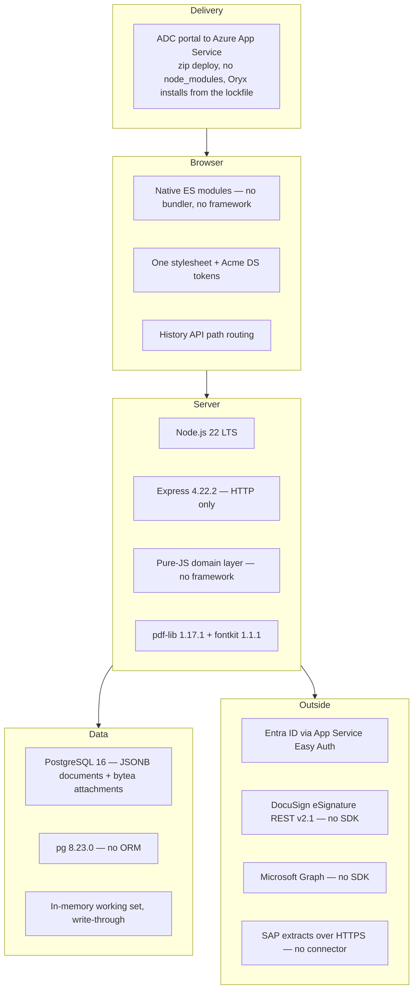

Four runtime dependencies. Eighty-eight packages in the whole lockfile tree, every one MIT / ISC /
BSD / 0BSD / Zlib. No build step, no transpiler, no bundler, no frontend package, no ORM, no auth
library, no SDK for any external system.

### 2.2 Runtime and platform

| Layer | Choice | Version | Why this and not the obvious alternative |
|---|---|---|---|
| Runtime | Node.js | **22 LTS** on App Service (`NODE\|22-lts`); 24.x locally | The ADC platform's supported Linux stack. One language across server, browser and tooling. |
| Host | Azure App Service, Linux, B1 | — | What ADC deploys. Always On carries the in-process scheduler; HTTPS-only, TLS 1.2, HTTP/2, FTP off. |
| Entry point | `server.js` at the repo root | — | ADC requirement — it is `main` and `start` in `package.json` and must not move. |
| Listener | `app.listen(process.env.PORT \|\| 8080, "0.0.0.0")` | — | Platform-assigned port; the literal form is an ADC scan target. |
| Config | `process.env` / App Service settings only | — | **No `.env` file anywhere.** No GUID, tenant id, client id or localhost URL may appear in source — `tools/preflight.ps1` greps for them before every upload. |

### 2.3 Server

| Concern | Choice | Notes |
|---|---|---|
| HTTP | **express 4.22.2** | Routing, JSON body parsing (25 MB cap for base64 uploads), static files. Nothing else — no session, no CSRF middleware (no cookies), no view engine. |
| Identity | **none** — the verbatim `currentUser(req)` helper | Reads Easy Auth's `x-ms-client-principal-name` / `x-ms-client-principal` headers. **Adding msal/passport/next-auth is prohibited**: ADC detects SSO by scanning for the literal string `x-ms-client-principal`. |
| Authorisation | `lib/domain/rbac.js` — one table | Roles to capabilities to nav sections, computed server-side and sent to the browser. |
| Domain logic | plain JavaScript modules, pure functions | `lib/domain/*` takes plain objects and returns plain objects. No storage, no network, no clock except through arguments — which is what makes 482 offline checks possible. |
| PDF | **pdf-lib 1.17.1** + **@pdf-lib/fontkit 1.1.1** | Generates the AFE Form and the simulated Certificate of Completion. Pure JS, no native code, no network at runtime, exact-pinned (no caret). |
| Typeface | **Carlito, vendored** — not a package | `lib/pdf/assets/Carlito-{Regular,Bold}.ttf` + `Carlito-OFL.txt`, built by `tools/build_form_font.py`. Metrically identical to the template's Calibri, OFL-1.1, so the form breaks lines where Acme's own form breaks them without redistributing a Microsoft font. Must be plain sfnt (`.ttf`, not WOFF) and embedded with `subset: false` — both traps render scattered letters rather than failing. |
| Crypto | Node's own `crypto` | DocuSign JWT (RS256), webhook HMAC, SHA-256 document hashes, constant-time secret compares. No crypto library. |
| HTTP client | global `fetch` | DocuSign and Graph are called directly. No axios, no SDK. |
| Jobs | `lib/scheduler.js` — `setInterval` + a database lease | Three jobs, 10-minute tick, 5-minute lease. No queue, no worker, no Functions app. |

### 2.4 Frontend

| Concern | Choice | Notes |
|---|---|---|
| Shell | `public/index.html` — 2 KB | Loads `public/js/app.js` as `<script type="module">`. |
| Modules | **native ES modules**, relative imports ending in `.js` | No bundler, no transpiler, no `node_modules` in the browser. Screen families load per route with dynamic `import()`. |
| Rendering | `core/dom.js` — auto-escaping `html` tag + `morph()` | Template literals produce escaped markup; `morph()` patches the existing DOM so scroll, focus and a half-typed field survive a repaint. **`innerHTML` after first paint is banned.** |
| Routing | `core/router.js` — History API, path routes | Express serves the shell for any non-API, non-file path; the router resolves it. Each screen gets a **fresh `<div class="screen">`** and binds its delegated listeners to that element. |
| State | `core/store.js` + `core/session.js` | A small cache and the `/api/me` result. No Redux, no signals library. |
| Styling | `public/css/app.css` + `public/ds/` tokens | Acme design-system tokens imported; the DS base layer deliberately not, so it cannot fight the B2C layout. |
| Accessibility | audited, not assumed | WCAG AA in the live DOM: every text node's computed background resolved, 4.5:1 (3:1 large). The DS primary green ships at 3.19:1; the deeper `#008943` (4.51) is used instead. |
| Tests | none by design | No build step means no test runner. Verified in the in-app browser: `node --check` per module, the reference AFE end to end at 1440 and 375, the contrast audit returning `[]`, an empty console. |

### 2.5 Data

| Concern | Choice | Notes |
|---|---|---|
| Database | **PostgreSQL 16** — Azure Flexible Server (UAT: B1ms Burstable); `postgres:16-alpine` locally on `127.0.0.1:5434` | Same engine, same major version, in both places. |
| Driver | **pg 8.23.0** | Pooled. **No ORM, no migration tool** — the schema is two tables created by `CREATE TABLE IF NOT EXISTS` on boot. |
| Shape | `documents(collection, id, doc JSONB)` + `attachments(storage_key, bytes BYTEA, …)` | Document storage in a relational engine: the domain moves fast, the schema does not have to move with it. |
| Access | `lib/repos/*` — the only stateful modules | Routes never touch storage internals. `lib/repos/index.js` is the swap point. |
| Mode | **write-through, read-from-memory** | The working set is a `Map`, so `all(pred)` / `find(pred)` take JS predicates; every mutation mirrors to Postgres. |
| No database | in-memory, hydrated from `seed/*.json` | `DATABASE_URL` absent means memory. A database that will not connect **logs loudly and falls back to memory** rather than failing to boot. |
| TLS | on unless the URL says `sslmode=disable` | The decision is never taken from a host name, so a deployed database cannot end up in the clear because a URL looked local. |

### 2.6 Documents, signatures, mail

| Seam | Live | Standing in | Switch |
|---|---|---|---|
| DocuSign | `docusignLive.js` — eSignature REST v2.1, JWT grant (RS256), anchor tabs, `listStatusChanges`, combined PDF + certificate | `docusignSim.js` — a stamped PDF and a Certificate of Completion **in DocuSign's own layout**, so the same parser and the same verification code run either way | `DOCUSIGN_INTEGRATION_KEY` |
| Mail | `graphMail.js` — app-only Graph scoped to the `RTR_FA` mailbox | outbox rows only; nothing leaves the building, and `/mailbox` shows every message exactly as Graph would receive it | `GRAPH_*` |
| SAP extracts | `POST /api/ingest/:kind` with `x-ingest-secret` | admin upload of the same file through the same pipeline | `INGEST_SECRET` |
| Scheduler | interval ticks | `POST /api/jobs/tick` with `JOBS_SECRET`, or an admin button | `SCHEDULER_ENABLED` |

### 2.7 Tooling

| Tool | Purpose |
|---|---|
| `tools/preflight.ps1` | The ADC gate: dependency list, `npm audit`, GUID / localhost grep, all seven smoke suites, then `app.zip`. |
| `tools/smoke-*.js` (7 suites, 482 checks) | Two run offline against the domain; five drive a real server over HTTP. |
| `tools/run-local.js` / `.ps1` | Starts the server **in its own process** (`require`, not `spawn`) — a wrapper that shells out leaves the real server holding port 8080. |
| `tools/build_afe_form.py` | **Generates** `lib/pdf/afeFormLayout.js` from the Global AFE Template and the PDF Excel prints from it. The layout file is never hand-edited. |
| `tools/build_form_font.py` | Rebuilds the vendored Carlito, cut to WinAnsi. |
| `tools/build_seeds.py` | Regenerates the reference seeds from the real exports (which are never committed). |
| `tools/seed-demo.js` | Fills an environment with AFEs across the lifecycle **through the API**, so every derived view is correct. Never run at boot. |
| `docker compose up -d db` | The local Postgres. |

Python appears only in build-time generators. It is not a runtime dependency and is not deployed.

### 2.8 Deliberately not in the stack

| Not used | Because |
|---|---|
| React / Vue / Svelte, any bundler or transpiler | ADC deploys a zip and runs `npm ci`; a build step is a second toolchain to keep alive and a second thing that can fail at upload. The screens are small and the DOM work is `morph()`. |
| An ORM or migration framework | Two tables and a JSONB column. An ORM would add a schema to migrate for every domain change the blueprint makes. |
| Any auth library | Prohibited by ADC. Identity is the platform's; the app only reads a header. |
| A DocuSign, Graph or Azure SDK | Each is a large dependency tree for a handful of REST calls. `crypto` + `fetch` cover them, and the supply-chain review stays at four packages. |
| A message broker or Functions app | Three jobs on a ten-minute tick with a database lease. Adding a broker would add infrastructure that the outbox table already models. |
| An SMTP catcher (MailPit was considered) | It would add a container to run, an SMTP client to the dependency list, and a copy of every message the audit trail knows nothing about. `/mailbox` reads the real outbox instead. |
| Any AI service | Non-negotiable — see §1. |

---

## 3. Architecture in block diagrams

### 3.1 L0 — System context

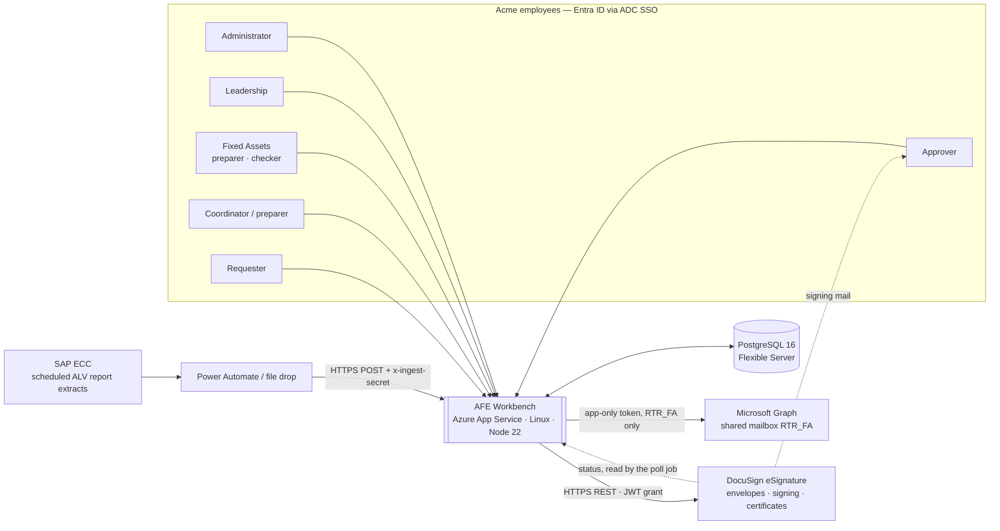

**What to look at.** Every arrow out of the box is either evidence coming back (DocuSign), reference
data coming in (SAP, one-way), or mail going out. Nothing else leaves. There is no arrow to an AI
service, and none *into* SAP.

### 3.2 L1 — Deployment blocks

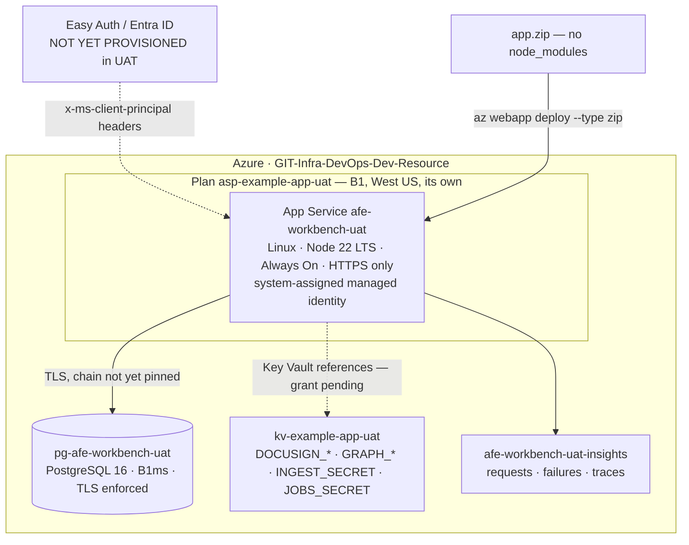

**What to look at.** Two blocks are dotted because they are not live yet, and both need rights this
account does not hold: the Entra app registration for Easy Auth (so `UNAUTHENTICATED_AS` is set and
`/health` reports `auth: "open"`), and *Key Vault Secrets User* for the managed identity (so secrets
are App Service settings for now). UAT is production's shape one size down — same components, same
relationships — which is the point of it.

### 3.3 L2 — Application blocks

This is the diagram to keep open while changing the code.

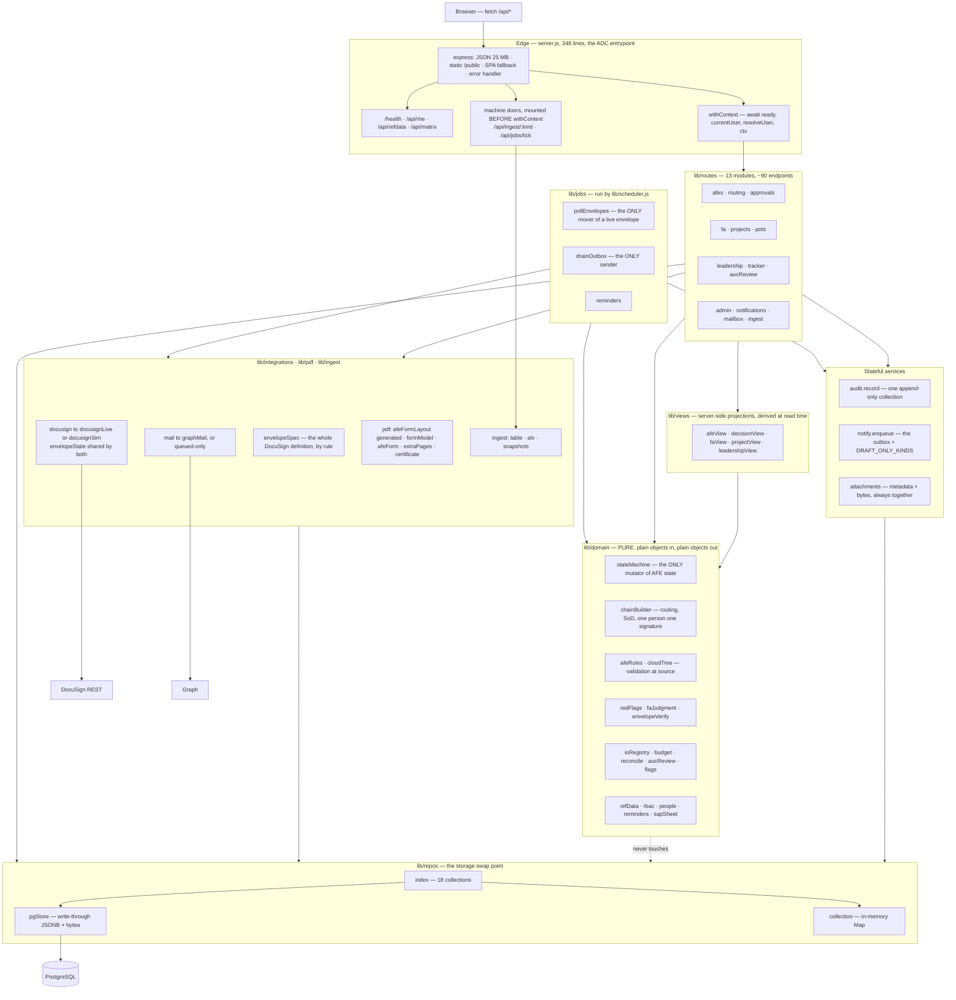

**What to look at — the four structural rules the diagram encodes.**

1. **The domain has no arrow to storage.** `lib/domain/*` is pure; it is handed what it needs. That
   is why 482 checks can run with no server and no database.
2. **One lifecycle mutator.** Everything that changes an AFE's state goes through
   `stateMachine.applyTransition()`. Routes call it; the UI only hides buttons.
3. **The machine doors are mounted before `withContext`.** `/api/ingest/*` and `/api/jobs/tick`
   carry no user identity — they authenticate with a shared secret compared in constant time, and
   ADC must exclude those paths from Easy Auth because a machine caller cannot follow an SSO redirect.
4. **Two jobs are named "the only".** A live DocuSign envelope moves only through `pollEnvelopes`
   (`recordSigned` refuses it otherwise), and mail is sent only by `drainOutbox`. Neither can be
   reached from a route.

### 3.4 The request pipeline — every mutation, without exception

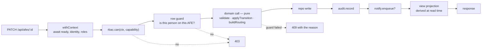

`guard → repo write → audit.record → notify.enqueue?` is the shape of every mutation in the system.
Audit is never nested on a document and never written ad hoc; the outbox is never bypassed.

### 3.5 Frontend blocks

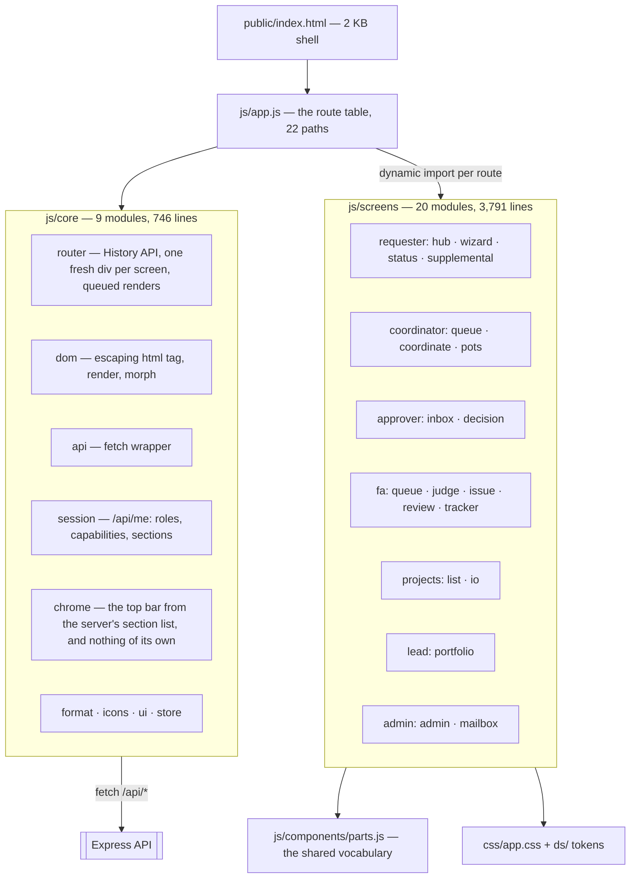

**What to look at.** Every screen exports `render(root, ctx)` and `unmount()`, and **takes the
element it is given** — never `#app`. Two failures taught that: handing every screen the same root
let delegated listeners from an earlier visit repaint the page as someone else's screen, and a
module-level `wired` flag survived `unmount()` and left a screen inert until a reload. Wiring binds
once per element (`S.wiredTo === root`).

The other rule the diagram cannot show: **a screen answers before the server does.** A chip or
toggle applies to the screen's own copy, repaints, *then* sends the PATCH; the reply repaints again
with the server's validation, and a refusal puts the old value back.

### 3.6 Persistence blocks

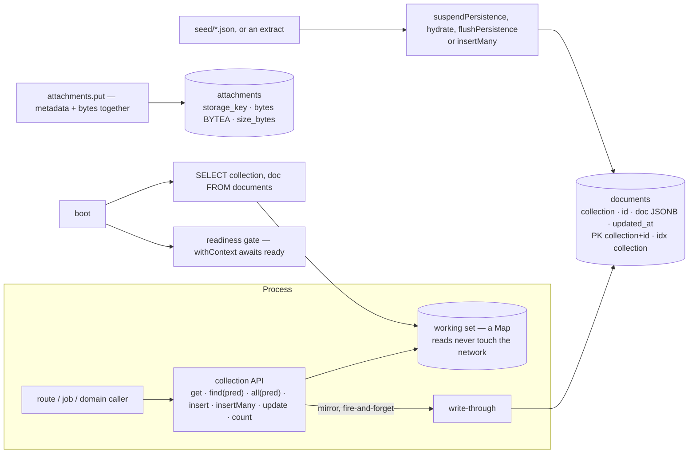

**What to look at — three hard-won rules.**

- **Bulk work must batch.** The per-row path is fire-and-forget and cannot keep up; a process that
  stops mid-reseed leaves the database holding a partial copy that the next boot restores as if it
  were complete. This bit us once: `/api/admin/reset` wiped the deployed dataset.
- **Requests await readiness.** App Service routes traffic the instant we listen; a request arriving
  mid-restore would otherwise read an empty store.
- **A database that will not connect falls back to memory and says so.** The app never fails to boot
  over storage.

### 3.7 Integration seams and their switches

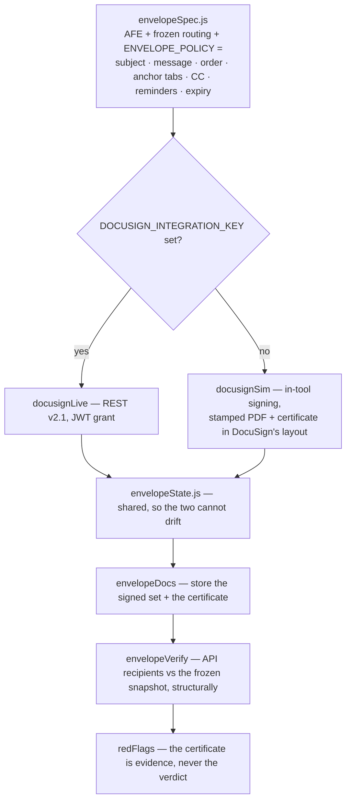

**What to look at.** Both providers build from the **same spec object**, so the simulated envelope
carries exactly what the live one would be created with — and the mail an approver receives is
DocuSign's own subject and body, queued by `notifySigner` while there is no integration key. Nobody
configures an envelope in a screen; changing how envelopes are configured means changing
`envelopeSpec.js` or `refData.ENVELOPE_POLICY`.

### 3.8 Extract ingest blocks

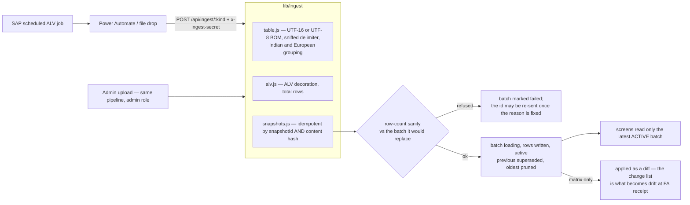

**What to look at.** Four kinds — `matrix`, `io_budget`, `io_master`, `po_lines` — under one
discipline. The matrix is the one kind whose import **deletes**: a cost centre missing from the
export has gone, in place, with no superseded batch behind it. It also ships as 1,197 seeded rows
with no snapshot, so "no previous batch" once meant "no check at all" and a two-row test extract
replaced all 1,197 without a murmur — `KINDS.matrix.liveCount` now counts what is about to be
overwritten.

### 3.9 Notification blocks — two doors, one decision

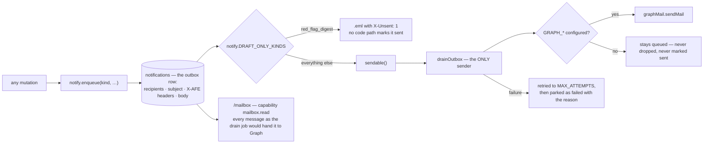

**What to look at.** Draft and send build the **same** Graph message shape (`messageBody`), so the
mail a person approves is the mail the job would have sent. And the outbox is a screen, not a log —
while there is no registration nothing leaves the building, and a queue nobody can read is
indistinguishable from a tool that quietly does nothing.

### 3.10 Job blocks

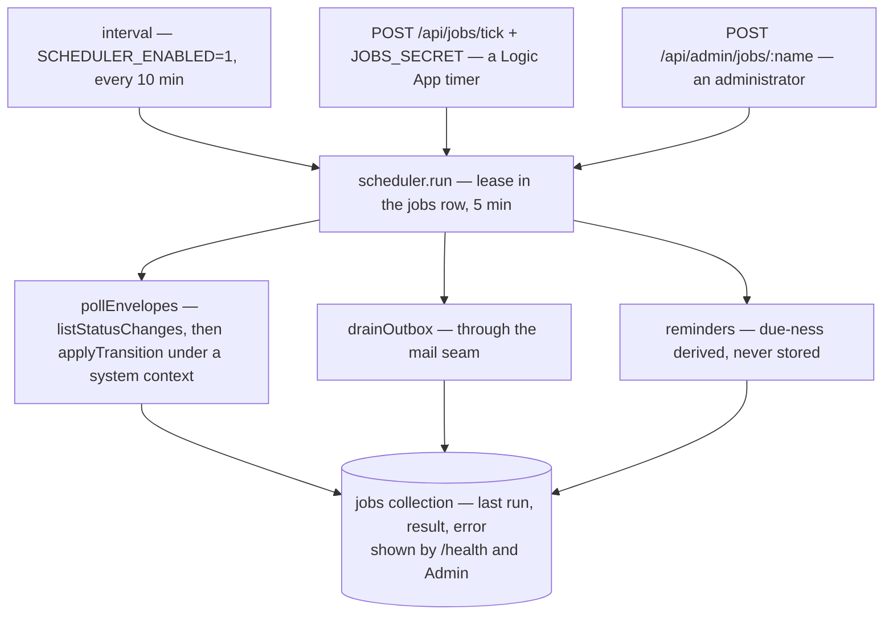

A signature that lands in DocuSign becomes a guarded, audited, notified transition here — the same
path as an in-tool one. The lease is approximate under the write-through store, which is fine for a
reminder (worst case, one duplicate nudge) and is noted for Phase 1.

---

## 4. The lifecycle

Thirteen states, fourteen transitions, one mutator.

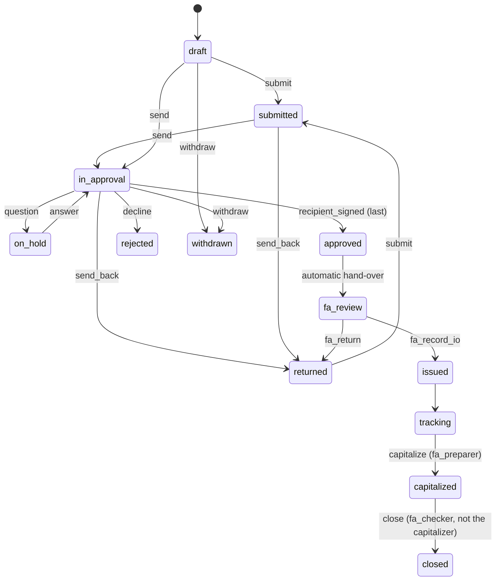

**The three rules that live in this table.**

- **On the last signature**, `applyTransition` writes **one** `afe_approved` row to the shared AFE
  mailbox (the org rule marked `handoff`, overridable with `FA_MAILBOX`) with a standard subject —
  `AFE APPROVED | <cost centre> | USD <total> | <title> | <id>` — and the same facts repeated as
  `X-AFE-*` headers, so the FA team's own workflow can trigger on either without parsing prose.
- **After an FA return**, `submit` compares `financialFingerprint(afe)` with the fingerprint frozen
  at send: unchanged means straight back to `fa_review` and the signatures stand; changed means a
  new round.
- **Capitalize and close are four eyes**, enforced by identity rather than by role, so holding both
  roles does not let one person do both halves.

---

## 5. Module inventory

| Block | Files | Lines | Responsibility |
|---|---:|---:|---|
| `server.js` | 1 | 348 | Entry point, identity helpers, `/health`, `/api/me`, `/api/refdata`, matrix lookups, route mounting, boot and the readiness gate. |
| `lib/domain` | 17 | 3,433 | Pure rules: lifecycle, chain builder, validation, red flags, FA judgment, IO registry, budget, reconciliation, AuC review, RBAC, reference data. |
| `lib/routes` | 13 | 2,079 | ~90 HTTP endpoints. Guards and orchestration only — no rules, no storage internals. |
| `lib/views` | 5 | 711 | Read-time projections: what a screen may see, and what is derived for it. |
| `lib/integrations` | 8 | 928 | DocuSign (live, simulated, shared state, certificate parser), envelope spec, mail, Graph. |
| `lib/pdf` | 5 | 1,311 | The AFE Form (generated layout + model + renderer), the extra pages, the certificate. |
| `lib/ingest` | 4 | 623 | The four SAP extracts: parsing, ALV cleanup, snapshot discipline. |
| `lib/repos` | 3 | 377 | The storage swap point: in-memory collections, write-through Postgres, attachment store. |
| `lib/jobs` | 3 | 231 | Poll envelopes, drain the outbox, send reminders. |
| `lib/{audit,notify,attachments,envelopeDocs,store,scheduler,routing}.js` | 7 | — | The stateful services every mutation passes through. |
| `public/js/core` | 9 | 746 | Router, DOM, API, session, chrome, formatting. |
| `public/js/screens` | 20 | 3,791 | Six personas' screens. |
| `public/css` | 1 | 522 | The one stylesheet. |
| `tools` | 14 | 4,024 | Smoke suites, preflight, generators, local runner, demo seeder. |

---

## 6. Data design

### 6.1 Physical schema — the whole of it

```sql
CREATE TABLE IF NOT EXISTS documents (
  collection TEXT NOT NULL,
  id         TEXT NOT NULL,
  doc        JSONB NOT NULL,
  updated_at TIMESTAMPTZ NOT NULL DEFAULT now(),
  PRIMARY KEY (collection, id)
);
CREATE TABLE IF NOT EXISTS attachments (
  storage_key TEXT PRIMARY KEY,
  bytes       BYTEA NOT NULL,
  size_bytes  INTEGER NOT NULL,
  created_at  TIMESTAMPTZ NOT NULL DEFAULT now()
);
CREATE INDEX IF NOT EXISTS documents_collection_idx ON documents (collection);
```

Queries are JS predicates over the in-memory working set, so there is no query planner to satisfy
and no index to design. The trade is memory: the whole working set lives in the process. At the
current size — 1,197 matrix rows, 528 recon lines, 495 budget rows, a few hundred AFEs — that is
tens of megabytes. **The seam to cross when it stops fitting is `lib/repos/index.js`, and nothing
above it changes.**

### 6.2 Collections

Eighteen, each with an id prefix: `users`(usr) · `afes`(afe) · `routings`(rtg) · `envelopes`(env) ·
`ios`(io) · `orgRules`(rule) · `budgetPots`(pot) · `directory`(dir) · `matrix`(mxr) ·
`snapshots`(imp) · `budgetRows`(bgr) · `ioMaster`(iom) · `poLines`(pol) · `tracker`(trk) ·
`notifications`(ntf) · `attachmentsMeta`(att) · `auditEvents`(aud) · `jobs`(job).

Seeded at boot from `seed/*.json` when the database is empty: 2,561 matrix rows collapsing to
**1,197** cost centres (ids are `mxr-<costCenter>`; the SAP report has one row per cost centre ×
plant), 528 recon lines, 495 budget baseline rows, 11 users, 4 org rules, 15 budget pots, 5
directory entries. The matrix seed carries real approver names, which is why the repo stays private;
budget figures in the seed are dummies.

### 6.3 Stored versus derived

| Stored, because it is a fact or evidence | Derived at read time, always |
|---|---|
| The AFE, its `routingEdits` and `ccRecipients` | validation, and what it decided (`applies`) |
| The **frozen routing snapshot** per round (a deep copy) | the chain preview, until send |
| The envelope, its recipient events, the signed set, the certificate | red flags, matrix drift, envelope verification |
| `formHash` at send | the KO01 keying sheet |
| FA judgment, acknowledgements, IO numbers | AuC review flags, per-IO figures, budget-pot KPIs |
| Extract batches and their rows | reminder due-ness, reconciliation notes |
| Every audit row | permissions on a row |

**Snapshots, not references** is the load-bearing half. A later matrix change never mutates an
in-flight chain — it raises a red flag at FA receipt. Re-routing creates a new `round`; old
recipients are marked `superseded`, never deleted. Red flags are cleared with facts (an
`email_approval` attachment acknowledged against that level and that name), never edited away.

---

## 7. Cross-cutting design

### 7.1 Identity and authorisation

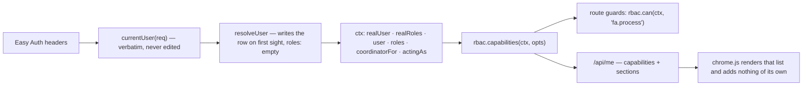

Seven roles — `requester` (the base role, held by everyone signed in), `approver`, `coordinator`,
`fa_preparer`, `fa_checker`, `leadership`, `admin` — grant capability strings; nine nav sections each
name the capability that earns them. Two deliberate asymmetries:

- **`admin` is not a superset of the operational roles.** An administrator configures the tool;
  someone who also runs Fixed Assets is given `fa_preparer` too, so that it *shows*.
- **Administration reads `realRoles`**, never the acted-as identity: viewing the tool as someone else
  must not carry the keys to the configuration with it.

A pending signature grants `approval.act` on its own, because the matrix names people who are not
users here, and asking an approver to be set up before they can sign is the delay this tool exists
to remove. Everyone signed in is a requester: an employee nobody has heard of signs in, is written
into `users` with no roles, and raises an AFE that minute.

### 7.2 Segregation of duties

A hard block, enforced **three times**: when the routing is built, again when the envelope is created
(`docusign.assertSegregation` runs on the frozen routing before any envelope exists), and in the
`stateMachine` guard. The requester, preparer and coordinator can never sign their own AFE; for a
matrix level, the next higher level not already signing stands in. Every exclusion is audited. A
person named at several levels signs **once, at the highest row**.

### 7.3 Audit

One append-only collection. Every row carries entity, entity id, AFE id, **the real actor and the
acted-as identity separately**, type, from/to state, a payload delta and a timestamp. Rows are never
updated or deleted — Phase 1 revokes UPDATE and DELETE at the grant level. Audit is never nested on a
document and never written inline.

### 7.4 The evidence chain

What makes an approval provable, end to end:

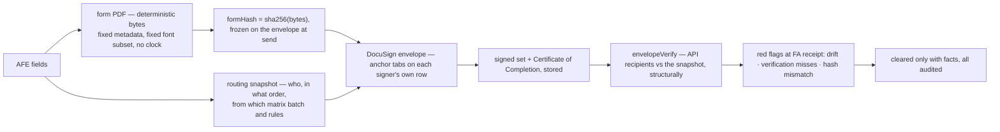

Same AFE, same bytes — which is what lets `GET /afes/:id/form/verify` re-check the hash afterwards.
The check re-renders with `afeNo` masked (the number is written back after signing, by design) and
treats a mismatch as a *warn* when audited edits explain it, a *block* when nothing does.

---

## 8. Non-functional design

| Attribute | How it is met | Where it will need work |
|---|---|---|
| **Latency** | Reads never touch the network — the working set is in memory. Screens answer optimistically and reconcile with the server's reply. Screen families load per route. | A working set that outgrows the process; see §6.1. |
| **Throughput** | Tens of concurrent users on B1. Express with no middleware stack to speak of. | Not a constraint at this scale. |
| **Availability** | Readiness gate before traffic; a database that will not connect falls back to memory; envelopes reconcile by polling after any outage. | Single instance by design. The job lease is approximate. |
| **Recovery** | All state is in Postgres; a new instance rebuilds from it. RPO = point-in-time restore granularity; RTO = redeploy + restore, minutes. | Backup retention to be set by Finance. |
| **Integrity** | One mutator, append-only audit, frozen snapshots, idempotent imports applied atomically. | — |
| **Security** | SSO only, no credentials handled, secrets from settings only, machine doors on constant-time secret compares, PDF-only uploads sniffed and capped at 10 MB, bytes never on the App Service filesystem. | Easy Auth and Key Vault, both pending (§3.2). |
| **Accessibility** | WCAG AA audited in the live DOM against computed backgrounds. | — |
| **Supply chain** | 4 direct dependencies, 88 packages, all permissive, exact-pinned where it matters; `npm audit` and a GUID/localhost grep before every upload. | `express@4.x` pulls `qs@6.15.3` with two moderate advisories reachable only through hostile query strings; the fix is Express 5, a major upgrade needing the same scrutiny `pg` and `pdf-lib` had. Accepted for UAT. |

---

## 9. Environments and deployment

| | Local | UAT | Production (target) |
|---|---|---|---|
| App | `node tools/run-local.js`, port 8080 | `afe-workbench-uat`, B1, West US, its own plan | ADC-onboarded App Service |
| Store | memory, or `docker compose up -d db` (PG 16 on 127.0.0.1:5434) | `pg-afe-workbench-uat`, PG 16, B1ms, TLS | production server, TLS chain pinned or managed identity |
| Identity | `UNAUTHENTICATED_AS` + `DEMO_MODE=1` | `UNAUTHENTICATED_AS` — `/health` says `auth: "open"` | Easy Auth + Entra SSO; both switches off |
| DocuSign | simulated | simulated | live, service user, JWT consent |
| Mail | queued only, read at `/mailbox` | queued only | Graph app-only, scoped to `RTR_FA` |
| Extracts | admin upload | admin upload | scheduled transfer to `/api/ingest/*` |

**Deploy.** `SCM_DO_BUILD_DURING_DEPLOYMENT=true`; zip **without** `node_modules`
(`Compress-Archive -Path server.js, package.json, package-lock.json, lib, seed, public`);
`az webapp deploy --type zip`. Redeploy = re-zip + deploy. Oryx installs from the lockfile.

**At ADC onboarding, ask for Easy Auth `excludedPaths`** on `/health`, `/api/ingest/*`,
`/api/docusign/connect` and `/api/jobs/tick` — machine callers cannot follow an SSO redirect.

---

## 10. Verification

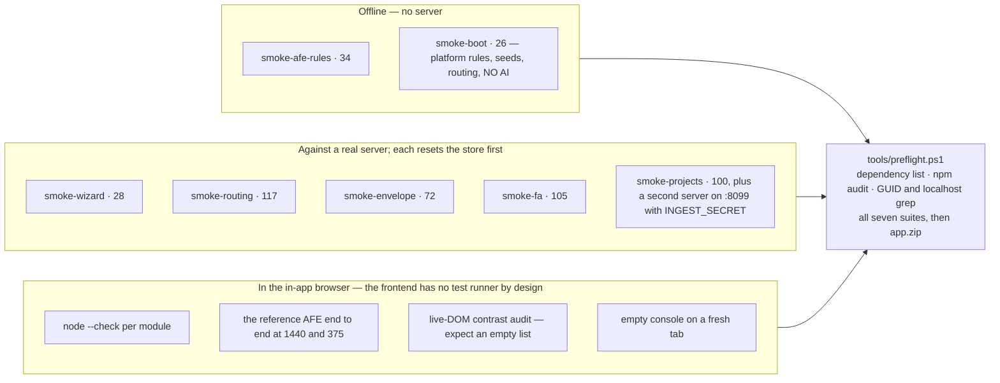

482 checks across seven suites; they pass against Postgres as well as memory, and must be run that
way after touching anything in `lib/repos/`. **Every HTTP suite resets the store first** — never
point them at UAT.

One rule no suite can enforce: **look at the form, do not only measure it.** Comparing drawing
operators against the template's print will pass while the page is unreadable, because a broken font
embed keeps every coordinate intact. Rasterise a render and look at it after any change to the PDF
pipeline.

---

## 11. Design decisions

| # | Decision | Alternative rejected | Why |
|---|---|---|---|
| 1 | Document storage in Postgres (JSONB) behind a collection API | Relational schema + ORM | The domain model moved four times in three weeks. Two tables absorbed every change; a migration per change would not have. |
| 2 | Write-through, read-from-memory | Query the database per read | Predicates stay JavaScript, so the domain is testable offline and screens are instant. The cost is memory, and the seam to cross is one file. |
| 3 | No build step on the frontend | React + Vite | ADC deploys a zip. A toolchain is a second thing that can fail at upload, for screens that are mostly one `morph()` call. |
| 4 | Purity in `lib/domain` as an invariant | Rules that read storage where convenient | It is the only reason 482 rules-level checks run with no server, and the reason a rule can be re-run at read time to derive a red flag. |
| 5 | One lifecycle mutator | State changes in routes | The audit trail is complete by construction, not by discipline. |
| 6 | Snapshots frozen at send | References resolved at read | SOX evidence must say what was true *then*. A later matrix change raises a flag instead of rewriting history. |
| 7 | Simulation behind every seam | Wait for accounts | UAT, the stakeholder demo and every smoke suite work before DocuSign, Graph or the SAP transfer exist — and the simulated certificate is parsed by the same code as the real one. |
| 8 | The outbox is a screen | An SMTP catcher (MailPit) | No extra container, no extra dependency, and every message is in the audit trail. |
| 9 | Four runtime dependencies, no SDKs | DocuSign / Graph / Azure SDKs | A security review of four pure-JS packages is tractable. `crypto` and `fetch` cover the REST calls. |
| 10 | The AFE Form layout is **generated** from the template | A hand-drawn likeness | The printed page is Acme's own, to the coordinate. Change the template, re-export, re-run the generator — never hand-edit `afeFormLayout.js`. |
| 11 | Business config as data (`refData.js`, `orgRules`) | Config baked into code paths | Bands, levels, envelope policy and routing rules change without a release; org rules are editable in Admin. |
| 12 | Division derived, never asked for | A dropdown on the wizard | A cost centre resolves to a division through the recon extract (115 of them) or `DIVISION_KEYWORDS`; the vocabulary is the recon file's own, so seeds, org rules and pots all key off the same word. |

---

## 12. Known gaps and Phase-1 work

**Not production-shaped yet** — both need rights this account does not hold:

1. **No Easy Auth in UAT.** An Entra app registration cannot be created from here; `UNAUTHENTICATED_AS`
   is set and every visitor arrives as one identity. `/health` says `auth: "open"` for exactly this
   reason.
2. **Key Vault is empty and ungranted.** Assigning *Key Vault Secrets User* to the app's managed
   identity needs Owner or User Access Administrator; secrets stay App Service settings until then.

**Engineering follow-ups:**

3. Database TLS is `rejectUnauthorized: false` — encrypted, chain not verified, because App Service's
   trust store lacks the Microsoft root. Pin the DigiCert root, or move to managed identity.
4. Revoke UPDATE and DELETE on `auditEvents` at the grant level.
5. The job lease is approximate under the write-through store; make it a real advisory lock if a
   second instance is ever run.
6. `express@4.x` → Express 5, with the dependency scrutiny that implies (§8).
7. The database is in East US while the app is in West US — a leftover, worth co-locating when there
   is a reason to recreate it.
8. The pages after the AFE Form (Project Details, the cost lines, Cloud CapEx) are hand-authored in
   `extraPages.js` and are not yet template-exact.

**Waiting on other people** — nothing in the code blocks on these: the DocuSign integration key, the
Graph app registration for `RTR_FA`, the four scheduled SAP extracts, ADC onboarding with Easy Auth
and its `excludedPaths`, and the open questions in `docs/v0.4-blueprint.md` §9.

### What changed since `docs/architecture.md` 0.4-draft-1 (2026-09-04)

| Then | Now |
|---|---|
| Shared plan `asp-example-app2-uat` | its own plan `asp-example-app-uat` — one app's load is no longer another product's problem |
| `DEMO_MODE` doubled as the identity fallback | `UNAUTHENTICATED_AS` is a separate, self-describing switch, reported by `/health` |
| Roles enforced per route, ad hoc | `lib/domain/rbac.js` — one table; capabilities and nav sections served from `/api/me` |
| Mail = an `.eml` download | outbox + `drainOutbox` + `graphMail` + the `/mailbox` screen; `DRAFT_ONLY_KINDS` decides by kind |
| The envelope assembled in the send path | `lib/integrations/envelopeSpec.js` — both providers build from one spec |
| `pdf-lib` alone | `@pdf-lib/fontkit` + vendored Carlito, so the form is set in the template's own typeface |
| `chaseGroups.js`, `public/legacy.html` | deleted |
